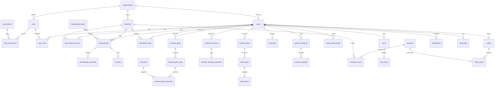
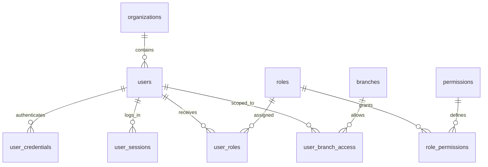
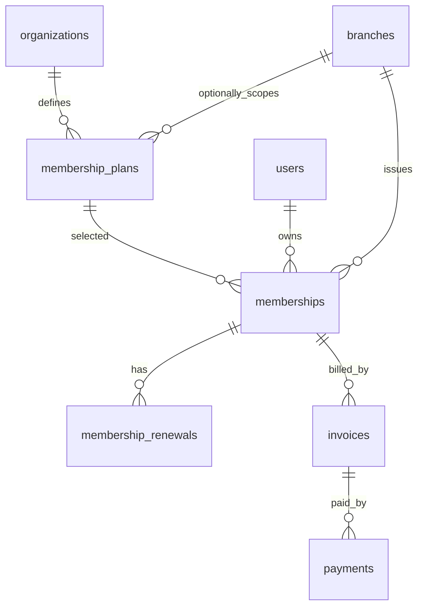
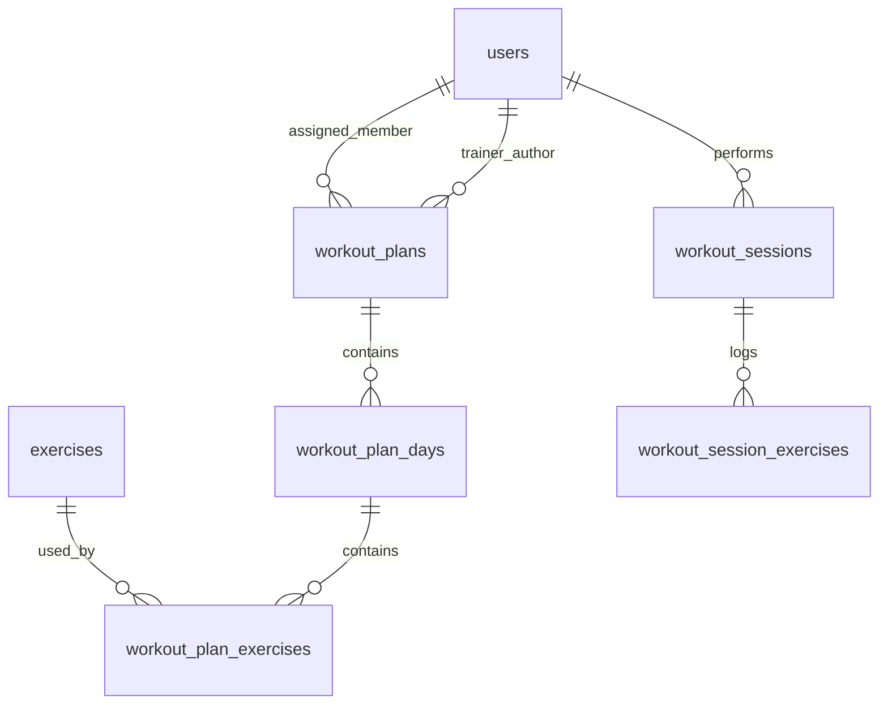
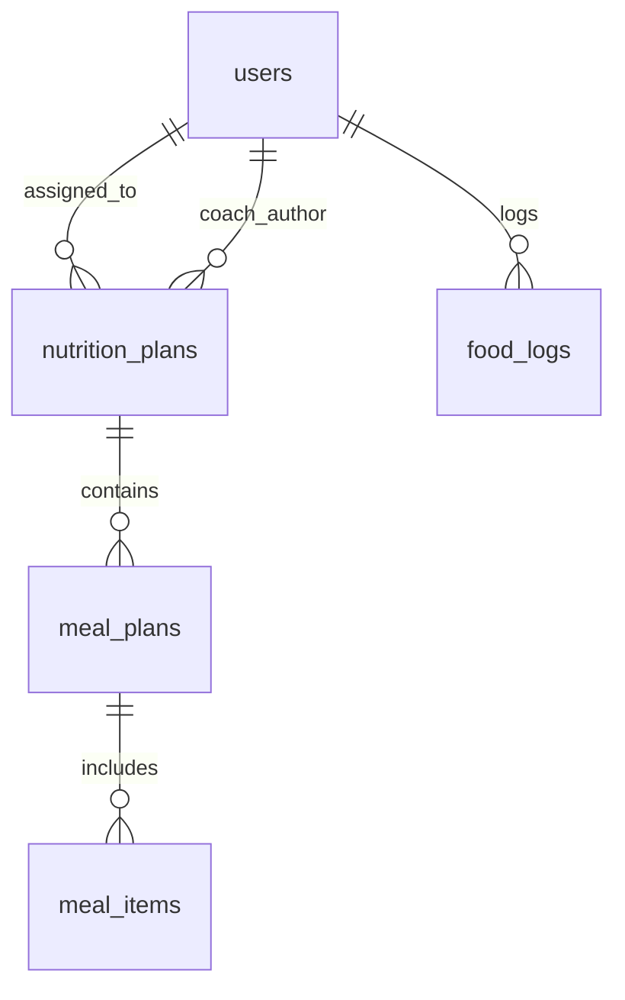
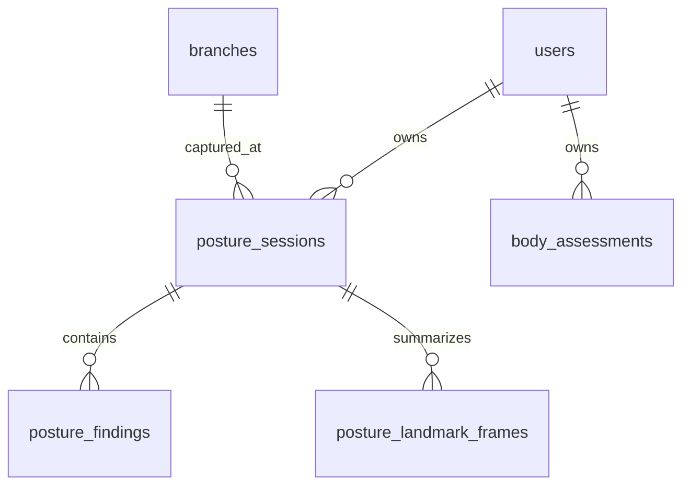
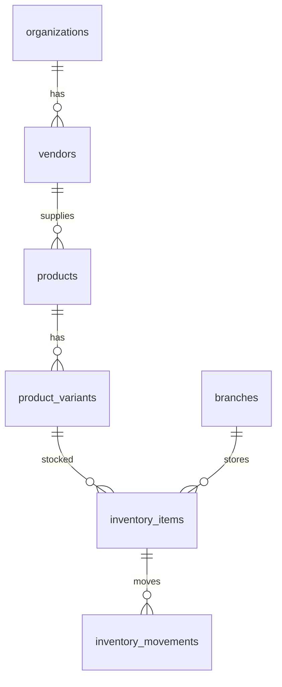
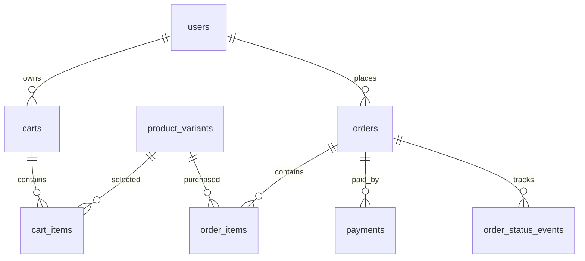
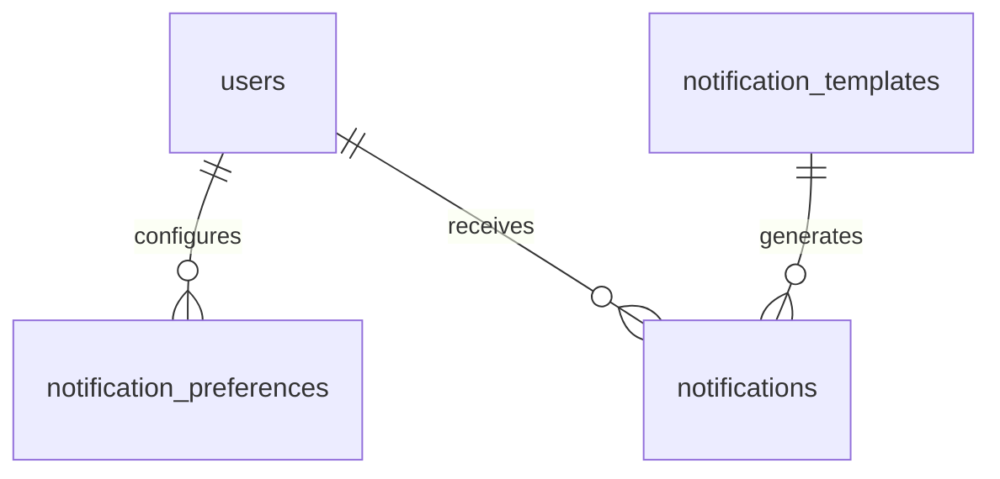

# FITFORGE AI - Phase 3: Complete PostgreSQL Database Schema

Status: Phase 3 draft for review

Approved stack:

- NestJS
- TypeScript
- PostgreSQL
- Prisma ORM
- Redis
- AWS
- Docker

This document defines the enterprise PostgreSQL database design for FITFORGE AI. It is optimized for a multi-tenant gym SaaS platform with multiple branches, role-based access control, audit logging, AI posture analysis, workout management, nutrition management, inventory, e-commerce, membership billing, notifications, analytics, and reporting.

---

## 1. Database Design Principles

### 1.1 Multi-Tenant Strategy

FITFORGE AI uses a shared PostgreSQL database with tenant scoping.

Primary tenant boundary:

- `organizations`

Operational branch boundary:

- `branches`

Most business records include one or both of:

- `organization_id`
- `branch_id`

This enables:

- Single-gym tenants
- Multi-branch gyms
- Franchise organizations
- Platform-level administration
- Branch-level access control
- Organization-level analytics

### 1.2 Data Isolation Rules

Every query from application services must enforce:

1. User identity from JWT.
2. User organization membership.
3. User branch access.
4. User role permissions.
5. Entity ownership where applicable.

Recommended enforcement layers:

- NestJS auth guard validates JWT.
- RBAC guard validates permissions.
- Tenant guard resolves organization and branch scope.
- Prisma middleware injects tenant filters for tenant-scoped models.
- Database foreign keys preserve relational integrity.
- Audit log records sensitive data changes.

### 1.3 Identifier Strategy

All primary keys should use UUIDs.

Recommended PostgreSQL extension:

```sql
CREATE EXTENSION IF NOT EXISTS "pgcrypto";
```

Default ID generation:

```sql
gen_random_uuid()
```

Prisma representation:

```prisma
id String @id @default(dbgenerated("gen_random_uuid()")) @db.Uuid
```

### 1.4 Time and Soft Deletion

All core mutable tables should include:

- `created_at`
- `updated_at`
- `deleted_at`

Hard deletion should be limited to:

- Temporary records
- Expired tokens
- Queue-related operational records

User-facing business data should use soft deletion for auditability.

### 1.5 Money and Currency

Use integer minor units for payment-safe accounting.

Example:

- INR 999.00 stored as `99900`
- USD 49.99 stored as `4999`

Fields:

- `amount_minor INTEGER`
- `currency CHAR(3)`

### 1.6 Analytics Strategy

PostgreSQL supports operational reporting. High-volume analytics should be streamed to a warehouse later through workers and event tables.

Operational analytics:

- Membership counts
- Attendance totals
- Revenue by branch
- Inventory stock
- Trainer performance

Future warehouse targets:

- Amazon Redshift
- Athena over S3
- OpenSearch for log/event exploration

---

## 2. Entity Relationship Overview



---

## 3. Enumerations

Recommended PostgreSQL enum types:

```sql
CREATE TYPE organization_type AS ENUM ('platform', 'single_gym', 'multi_branch_gym', 'franchise');
CREATE TYPE record_status AS ENUM ('active', 'inactive', 'suspended', 'archived');
CREATE TYPE user_status AS ENUM ('pending', 'active', 'inactive', 'blocked', 'deleted');
CREATE TYPE system_role AS ENUM ('admin', 'fitness_manager', 'trainer', 'receptionist', 'member');
CREATE TYPE membership_status AS ENUM ('pending', 'active', 'expired', 'paused', 'cancelled');
CREATE TYPE attendance_method AS ENUM ('qr', 'manual', 'biometric', 'mobile');
CREATE TYPE workout_goal AS ENUM ('fat_loss', 'muscle_gain', 'strength', 'bodybuilding', 'powerlifting', 'functional_fitness', 'sports_performance', 'general_fitness');
CREATE TYPE workout_session_status AS ENUM ('planned', 'in_progress', 'completed', 'skipped', 'cancelled');
CREATE TYPE meal_type AS ENUM ('breakfast', 'lunch', 'dinner', 'snack');
CREATE TYPE posture_source AS ENUM ('mobile_camera', 'uploaded_video', 'trainer_capture');
CREATE TYPE severity_level AS ENUM ('low', 'medium', 'high', 'critical');
CREATE TYPE product_category AS ENUM ('apparel', 'footwear', 'accessory', 'equipment', 'supplement');
CREATE TYPE order_status AS ENUM ('draft', 'pending_payment', 'paid', 'processing', 'fulfilled', 'cancelled', 'refunded');
CREATE TYPE payment_status AS ENUM ('pending', 'authorized', 'paid', 'failed', 'refunded', 'cancelled');
CREATE TYPE notification_channel AS ENUM ('push', 'email', 'sms', 'in_app');
CREATE TYPE notification_status AS ENUM ('pending', 'sent', 'delivered', 'read', 'failed');
```

Prisma can model these as enums and generate the equivalent database enum types.

---

## 4. Core Multi-Tenant Schema

### 4.1 `organizations`

Represents a tenant, gym brand, franchise, or platform-level organization.

| Column | Type | Constraints | Description |
|---|---|---|---|
| `id` | UUID | PK, default `gen_random_uuid()` | Organization ID |
| `name` | VARCHAR(160) | NOT NULL | Legal or display name |
| `slug` | VARCHAR(120) | NOT NULL, UNIQUE | URL-safe tenant slug |
| `type` | organization_type | NOT NULL | Tenant type |
| `status` | record_status | NOT NULL, default `active` | Operational status |
| `billing_email` | VARCHAR(255) | NULL | Billing contact |
| `timezone` | VARCHAR(64) | NOT NULL, default `UTC` | Default organization timezone |
| `settings` | JSONB | NOT NULL, default `{}` | Tenant configuration |
| `created_at` | TIMESTAMPTZ | NOT NULL | Created timestamp |
| `updated_at` | TIMESTAMPTZ | NOT NULL | Updated timestamp |
| `deleted_at` | TIMESTAMPTZ | NULL | Soft delete marker |

Indexes:

- `UNIQUE (slug)`
- `INDEX (status)`
- `GIN (settings)`

### 4.2 `branches`

Represents a physical gym branch.

| Column | Type | Constraints | Description |
|---|---|---|---|
| `id` | UUID | PK | Branch ID |
| `organization_id` | UUID | FK `organizations.id`, NOT NULL | Tenant owner |
| `name` | VARCHAR(160) | NOT NULL | Branch name |
| `code` | VARCHAR(64) | NOT NULL | Branch code within organization |
| `status` | record_status | NOT NULL, default `active` | Branch status |
| `address_line1` | VARCHAR(255) | NULL | Address |
| `address_line2` | VARCHAR(255) | NULL | Address |
| `city` | VARCHAR(120) | NULL | City |
| `state` | VARCHAR(120) | NULL | State |
| `country` | CHAR(2) | NULL | ISO country |
| `postal_code` | VARCHAR(24) | NULL | Postal code |
| `phone` | VARCHAR(32) | NULL | Branch phone |
| `email` | VARCHAR(255) | NULL | Branch email |
| `timezone` | VARCHAR(64) | NOT NULL, default `UTC` | Branch timezone |
| `metadata` | JSONB | NOT NULL, default `{}` | Extensible metadata |
| `created_at` | TIMESTAMPTZ | NOT NULL | Created timestamp |
| `updated_at` | TIMESTAMPTZ | NOT NULL | Updated timestamp |
| `deleted_at` | TIMESTAMPTZ | NULL | Soft delete marker |

Constraints:

- `UNIQUE (organization_id, code)`
- `country` should be ISO-3166 alpha-2 when present.

Indexes:

- `INDEX (organization_id, status)`
- `INDEX (organization_id, city)`

---

## 5. Identity, RBAC, and Access Control



### 5.1 `users`

| Column | Type | Constraints | Description |
|---|---|---|---|
| `id` | UUID | PK | User ID |
| `organization_id` | UUID | FK `organizations.id`, NULL | Tenant scope; null only for platform users |
| `email` | VARCHAR(255) | UNIQUE, NOT NULL | Login email |
| `phone` | VARCHAR(32) | UNIQUE, NULL | Phone number |
| `first_name` | VARCHAR(100) | NOT NULL | First name |
| `last_name` | VARCHAR(100) | NOT NULL | Last name |
| `status` | user_status | NOT NULL, default `pending` | Account status |
| `date_of_birth` | DATE | NULL | Member profile |
| `gender` | VARCHAR(40) | NULL | Optional profile value |
| `profile_image_url` | TEXT | NULL | Profile image |
| `last_login_at` | TIMESTAMPTZ | NULL | Last successful login |
| `metadata` | JSONB | NOT NULL, default `{}` | Extensible profile metadata |
| `created_at` | TIMESTAMPTZ | NOT NULL | Created timestamp |
| `updated_at` | TIMESTAMPTZ | NOT NULL | Updated timestamp |
| `deleted_at` | TIMESTAMPTZ | NULL | Soft delete marker |

Indexes:

- `UNIQUE (email)`
- `UNIQUE (phone)` where `phone IS NOT NULL`
- `INDEX (organization_id, status)`
- `INDEX (organization_id, last_name, first_name)`

### 5.2 `user_credentials`

Stores local password authentication data. OAuth identities can be added in a separate table later.

| Column | Type | Constraints | Description |
|---|---|---|---|
| `id` | UUID | PK | Credential ID |
| `user_id` | UUID | FK `users.id`, UNIQUE, NOT NULL | Owning user |
| `password_hash` | TEXT | NOT NULL | Argon2id or bcrypt hash |
| `password_updated_at` | TIMESTAMPTZ | NOT NULL | Password change time |
| `mfa_enabled` | BOOLEAN | NOT NULL, default false | MFA flag |
| `mfa_secret_encrypted` | TEXT | NULL | Encrypted MFA secret |
| `failed_login_count` | INTEGER | NOT NULL, default 0 | Lockout support |
| `locked_until` | TIMESTAMPTZ | NULL | Temporary lockout |
| `created_at` | TIMESTAMPTZ | NOT NULL | Created timestamp |
| `updated_at` | TIMESTAMPTZ | NOT NULL | Updated timestamp |

### 5.3 `roles`

| Column | Type | Constraints | Description |
|---|---|---|---|
| `id` | UUID | PK | Role ID |
| `organization_id` | UUID | FK `organizations.id`, NULL | Null for global platform roles |
| `name` | VARCHAR(100) | NOT NULL | Display name |
| `system_key` | system_role | NULL | Built-in role mapping |
| `description` | TEXT | NULL | Role description |
| `is_system` | BOOLEAN | NOT NULL, default false | Protects built-in roles |
| `created_at` | TIMESTAMPTZ | NOT NULL | Created timestamp |
| `updated_at` | TIMESTAMPTZ | NOT NULL | Updated timestamp |

Constraints:

- `UNIQUE (organization_id, name)`
- `UNIQUE (organization_id, system_key)` where `system_key IS NOT NULL`

### 5.4 `permissions`

| Column | Type | Constraints | Description |
|---|---|---|---|
| `id` | UUID | PK | Permission ID |
| `key` | VARCHAR(120) | UNIQUE, NOT NULL | Permission key |
| `module` | VARCHAR(80) | NOT NULL | Permission module |
| `description` | TEXT | NULL | Permission description |
| `created_at` | TIMESTAMPTZ | NOT NULL | Created timestamp |

Permission key examples:

- `branches.read`
- `members.create`
- `memberships.renew`
- `attendance.check_in`
- `workouts.assign`
- `nutrition.assign`
- `inventory.manage`
- `orders.manage`
- `analytics.view`
- `audit_logs.view`
- `roles.manage`

### 5.5 `role_permissions`

| Column | Type | Constraints | Description |
|---|---|---|---|
| `role_id` | UUID | FK `roles.id`, PK part | Role |
| `permission_id` | UUID | FK `permissions.id`, PK part | Permission |
| `created_at` | TIMESTAMPTZ | NOT NULL | Created timestamp |

Primary key:

- `(role_id, permission_id)`

### 5.6 `user_roles`

| Column | Type | Constraints | Description |
|---|---|---|---|
| `id` | UUID | PK | Assignment ID |
| `user_id` | UUID | FK `users.id`, NOT NULL | User |
| `role_id` | UUID | FK `roles.id`, NOT NULL | Role |
| `organization_id` | UUID | FK `organizations.id`, NOT NULL | Tenant scope |
| `branch_id` | UUID | FK `branches.id`, NULL | Optional branch scope |
| `created_by` | UUID | FK `users.id`, NULL | Actor |
| `created_at` | TIMESTAMPTZ | NOT NULL | Created timestamp |

Constraints:

- `UNIQUE (user_id, role_id, organization_id, branch_id)`

Indexes:

- `INDEX (user_id, organization_id)`
- `INDEX (organization_id, branch_id)`

### 5.7 `user_branch_access`

Defines explicit branch access for staff and members.

| Column | Type | Constraints | Description |
|---|---|---|---|
| `id` | UUID | PK | Access ID |
| `user_id` | UUID | FK `users.id`, NOT NULL | User |
| `organization_id` | UUID | FK `organizations.id`, NOT NULL | Tenant |
| `branch_id` | UUID | FK `branches.id`, NOT NULL | Branch |
| `is_primary` | BOOLEAN | NOT NULL, default false | Primary branch |
| `created_at` | TIMESTAMPTZ | NOT NULL | Created timestamp |

Constraints:

- `UNIQUE (user_id, branch_id)`

Indexes:

- `INDEX (organization_id, branch_id)`
- `INDEX (user_id, is_primary)`

### 5.8 `user_sessions`

Stores refresh-token sessions and device metadata.

| Column | Type | Constraints | Description |
|---|---|---|---|
| `id` | UUID | PK | Session ID |
| `user_id` | UUID | FK `users.id`, NOT NULL | User |
| `refresh_token_hash` | TEXT | NOT NULL | Hashed refresh token |
| `device_id` | VARCHAR(160) | NULL | Device identifier |
| `device_name` | VARCHAR(160) | NULL | Device display name |
| `ip_address` | INET | NULL | Login IP |
| `user_agent` | TEXT | NULL | User agent |
| `expires_at` | TIMESTAMPTZ | NOT NULL | Expiry |
| `revoked_at` | TIMESTAMPTZ | NULL | Revocation timestamp |
| `created_at` | TIMESTAMPTZ | NOT NULL | Created timestamp |

Indexes:

- `INDEX (user_id, expires_at)`
- `INDEX (refresh_token_hash)`

### 5.9 Built-In Role Permission Matrix

The following roles should be seeded per organization. Platform-level super administration can be added later as a separate platform role, but the approved operating roles for this phase are:

| Permission Area | Admin | Fitness Manager | Trainer | Receptionist | Member |
|---|---:|---:|---:|---:|---:|
| Branch management | Full | Read | None | Read assigned branch | None |
| Staff management | Full | Manage trainers | None | None | None |
| Member profiles | Full | Read/update fitness fields | Assigned members | Create/read/update front-desk fields | Own profile |
| Memberships and renewals | Full | Read | Read assigned members | Create/renew/pause | Own membership |
| Attendance | Full | Read reports | Read assigned members | Check-in/check-out/manual fixes | Own attendance |
| Workout plans | Full | Full | Create/assign assigned members | None | View/perform own |
| Nutrition plans | Full | Assign/review | Limited assigned-member guidance | None | View/log own |
| AI posture reports | Full | Review branch members | Review assigned members | None | Own reports |
| Inventory | Full | Read | None | Sell/read stock | Browse products |
| E-commerce orders | Full | Read | None | Create assisted sale | Own orders |
| Notifications | Full | Branch campaigns | Assigned-member messages | Renewal reminders | Own notifications |
| Analytics | Full | Branch fitness analytics | Own client analytics | Front-desk reports | Own progress |
| Audit logs | Full | Read fitness-area events | None | None | None |
| RBAC | Full | None | None | None | None |

Seeded role keys:

- `admin`
- `fitness_manager`
- `trainer`
- `receptionist`
- `member`

The application should resolve permissions from `user_roles -> roles -> role_permissions -> permissions` and then apply branch scoping from `user_branch_access`.

---

## 6. Membership and Billing Schema



### 6.1 `membership_plans`

| Column | Type | Constraints | Description |
|---|---|---|---|
| `id` | UUID | PK | Plan ID |
| `organization_id` | UUID | FK, NOT NULL | Tenant |
| `branch_id` | UUID | FK, NULL | Branch-specific plan |
| `name` | VARCHAR(140) | NOT NULL | Plan name |
| `description` | TEXT | NULL | Plan details |
| `duration_days` | INTEGER | NOT NULL, CHECK `> 0` | Plan duration |
| `price_minor` | INTEGER | NOT NULL, CHECK `>= 0` | Price in minor units |
| `currency` | CHAR(3) | NOT NULL | ISO currency |
| `features` | JSONB | NOT NULL, default `{}` | Included features |
| `status` | record_status | NOT NULL | Plan status |
| `created_at` | TIMESTAMPTZ | NOT NULL | Created timestamp |
| `updated_at` | TIMESTAMPTZ | NOT NULL | Updated timestamp |
| `deleted_at` | TIMESTAMPTZ | NULL | Soft delete |

Indexes:

- `INDEX (organization_id, branch_id, status)`
- `UNIQUE (organization_id, branch_id, name)` where `deleted_at IS NULL`

### 6.2 `memberships`

| Column | Type | Constraints | Description |
|---|---|---|---|
| `id` | UUID | PK | Membership ID |
| `organization_id` | UUID | FK, NOT NULL | Tenant |
| `branch_id` | UUID | FK, NOT NULL | Branch |
| `member_id` | UUID | FK `users.id`, NOT NULL | Member |
| `plan_id` | UUID | FK `membership_plans.id`, NOT NULL | Selected plan |
| `status` | membership_status | NOT NULL | Status |
| `start_date` | DATE | NOT NULL | Membership start |
| `end_date` | DATE | NOT NULL | Membership end |
| `auto_renew` | BOOLEAN | NOT NULL, default false | Auto-renew flag |
| `price_minor` | INTEGER | NOT NULL | Price snapshot |
| `currency` | CHAR(3) | NOT NULL | Currency snapshot |
| `created_by` | UUID | FK `users.id`, NULL | Staff actor |
| `created_at` | TIMESTAMPTZ | NOT NULL | Created timestamp |
| `updated_at` | TIMESTAMPTZ | NOT NULL | Updated timestamp |
| `cancelled_at` | TIMESTAMPTZ | NULL | Cancellation timestamp |

Constraints:

- `CHECK (end_date >= start_date)`
- One active membership per member and branch can be enforced with a partial unique index.

Indexes:

- `INDEX (organization_id, branch_id, status)`
- `INDEX (member_id, status)`
- `INDEX (branch_id, end_date)`
- `UNIQUE (member_id, branch_id) WHERE status = 'active'`

### 6.3 `membership_renewals`

| Column | Type | Constraints | Description |
|---|---|---|---|
| `id` | UUID | PK | Renewal ID |
| `membership_id` | UUID | FK, NOT NULL | Membership |
| `previous_end_date` | DATE | NOT NULL | Prior end |
| `new_end_date` | DATE | NOT NULL | New end |
| `amount_minor` | INTEGER | NOT NULL | Renewal amount |
| `currency` | CHAR(3) | NOT NULL | Currency |
| `processed_by` | UUID | FK `users.id`, NULL | Staff actor |
| `created_at` | TIMESTAMPTZ | NOT NULL | Created timestamp |

Indexes:

- `INDEX (membership_id, created_at)`

### 6.4 `invoices`

| Column | Type | Constraints | Description |
|---|---|---|---|
| `id` | UUID | PK | Invoice ID |
| `organization_id` | UUID | FK, NOT NULL | Tenant |
| `branch_id` | UUID | FK, NULL | Branch |
| `member_id` | UUID | FK `users.id`, NOT NULL | Billed member |
| `membership_id` | UUID | FK, NULL | Related membership |
| `invoice_number` | VARCHAR(80) | NOT NULL | Tenant invoice number |
| `subtotal_minor` | INTEGER | NOT NULL | Subtotal |
| `tax_minor` | INTEGER | NOT NULL, default 0 | Tax |
| `discount_minor` | INTEGER | NOT NULL, default 0 | Discount |
| `total_minor` | INTEGER | NOT NULL | Total |
| `currency` | CHAR(3) | NOT NULL | Currency |
| `due_date` | DATE | NULL | Due date |
| `paid_at` | TIMESTAMPTZ | NULL | Paid timestamp |
| `created_at` | TIMESTAMPTZ | NOT NULL | Created timestamp |

Constraints:

- `UNIQUE (organization_id, invoice_number)`
- `CHECK (total_minor >= 0)`

### 6.5 `payments`

| Column | Type | Constraints | Description |
|---|---|---|---|
| `id` | UUID | PK | Payment ID |
| `organization_id` | UUID | FK, NOT NULL | Tenant |
| `branch_id` | UUID | FK, NULL | Branch |
| `invoice_id` | UUID | FK `invoices.id`, NULL | Invoice |
| `order_id` | UUID | FK `orders.id`, NULL | E-commerce order |
| `provider` | VARCHAR(40) | NOT NULL | Stripe, Razorpay, PayPal |
| `provider_payment_id` | VARCHAR(160) | NULL | Provider ID |
| `idempotency_key` | VARCHAR(160) | NOT NULL | Payment idempotency |
| `status` | payment_status | NOT NULL | Payment status |
| `amount_minor` | INTEGER | NOT NULL | Amount |
| `currency` | CHAR(3) | NOT NULL | Currency |
| `failure_reason` | TEXT | NULL | Failure reason |
| `metadata` | JSONB | NOT NULL, default `{}` | Provider metadata |
| `created_at` | TIMESTAMPTZ | NOT NULL | Created timestamp |
| `updated_at` | TIMESTAMPTZ | NOT NULL | Updated timestamp |

Constraints:

- `UNIQUE (organization_id, idempotency_key)`
- `UNIQUE (provider, provider_payment_id)` where `provider_payment_id IS NOT NULL`

Indexes:

- `INDEX (organization_id, branch_id, status)`
- `INDEX (invoice_id)`
- `INDEX (order_id)`

---

## 7. Attendance Tracking Schema

### 7.1 `attendance_logs`

| Column | Type | Constraints | Description |
|---|---|---|---|
| `id` | UUID | PK | Attendance log ID |
| `organization_id` | UUID | FK, NOT NULL | Tenant |
| `branch_id` | UUID | FK, NOT NULL | Branch |
| `member_id` | UUID | FK `users.id`, NOT NULL | Member |
| `method` | attendance_method | NOT NULL | Check-in method |
| `check_in_at` | TIMESTAMPTZ | NOT NULL | Check-in time |
| `check_out_at` | TIMESTAMPTZ | NULL | Check-out time |
| `device_id` | VARCHAR(160) | NULL | Biometric, kiosk, or mobile device |
| `created_by` | UUID | FK `users.id`, NULL | Manual actor |
| `metadata` | JSONB | NOT NULL, default `{}` | Device metadata |
| `created_at` | TIMESTAMPTZ | NOT NULL | Created timestamp |

Constraints:

- `CHECK (check_out_at IS NULL OR check_out_at >= check_in_at)`

Indexes:

- `INDEX (organization_id, branch_id, check_in_at DESC)`
- `INDEX (member_id, check_in_at DESC)`
- `INDEX (branch_id, method, check_in_at DESC)`

Partitioning:

- Monthly range partition on `check_in_at` for high-volume branches.

---

## 8. Workout Management Schema



### 8.1 `exercises`

| Column | Type | Constraints | Description |
|---|---|---|---|
| `id` | UUID | PK | Exercise ID |
| `organization_id` | UUID | FK, NULL | Null for global catalog |
| `name` | VARCHAR(160) | NOT NULL | Exercise name |
| `slug` | VARCHAR(160) | NOT NULL | URL-safe name |
| `description` | TEXT | NULL | Description |
| `primary_muscle_group` | VARCHAR(80) | NOT NULL | Primary target |
| `secondary_muscle_groups` | TEXT[] | NOT NULL, default `{}` | Secondary targets |
| `equipment` | TEXT[] | NOT NULL, default `{}` | Equipment list |
| `difficulty` | VARCHAR(40) | NOT NULL | Beginner/intermediate/advanced |
| `instructions` | TEXT | NOT NULL | Execution instructions |
| `safety_instructions` | TEXT | NULL | Safety guidance |
| `common_mistakes` | TEXT | NULL | Common mistakes |
| `coaching_tips` | TEXT | NULL | Coaching cues |
| `image_url` | TEXT | NULL | Image asset |
| `video_url` | TEXT | NULL | Video asset |
| `status` | record_status | NOT NULL, default `active` | Catalog status |
| `created_at` | TIMESTAMPTZ | NOT NULL | Created timestamp |
| `updated_at` | TIMESTAMPTZ | NOT NULL | Updated timestamp |

Indexes:

- `UNIQUE (organization_id, slug)`
- `INDEX (primary_muscle_group, difficulty)`
- `GIN (secondary_muscle_groups)`
- `GIN (equipment)`

### 8.2 `workout_plans`

| Column | Type | Constraints | Description |
|---|---|---|---|
| `id` | UUID | PK | Workout plan ID |
| `organization_id` | UUID | FK, NOT NULL | Tenant |
| `branch_id` | UUID | FK, NULL | Branch scope |
| `member_id` | UUID | FK `users.id`, NOT NULL | Assigned member |
| `trainer_id` | UUID | FK `users.id`, NULL | Assigning trainer |
| `name` | VARCHAR(160) | NOT NULL | Plan name |
| `goal` | workout_goal | NOT NULL | Fitness goal |
| `description` | TEXT | NULL | Plan notes |
| `start_date` | DATE | NULL | Start date |
| `end_date` | DATE | NULL | End date |
| `status` | record_status | NOT NULL, default `active` | Plan status |
| `created_at` | TIMESTAMPTZ | NOT NULL | Created timestamp |
| `updated_at` | TIMESTAMPTZ | NOT NULL | Updated timestamp |
| `deleted_at` | TIMESTAMPTZ | NULL | Soft delete |

Indexes:

- `INDEX (organization_id, branch_id, status)`
- `INDEX (member_id, status)`
- `INDEX (trainer_id, status)`

### 8.3 `workout_plan_days`

| Column | Type | Constraints | Description |
|---|---|---|---|
| `id` | UUID | PK | Day ID |
| `workout_plan_id` | UUID | FK, NOT NULL | Parent plan |
| `day_number` | INTEGER | NOT NULL | Sequence number |
| `title` | VARCHAR(140) | NOT NULL | Day title |
| `notes` | TEXT | NULL | Coach notes |

Constraints:

- `UNIQUE (workout_plan_id, day_number)`

### 8.4 `workout_plan_exercises`

| Column | Type | Constraints | Description |
|---|---|---|---|
| `id` | UUID | PK | Assignment ID |
| `workout_plan_day_id` | UUID | FK, NOT NULL | Parent day |
| `exercise_id` | UUID | FK, NOT NULL | Exercise |
| `sort_order` | INTEGER | NOT NULL | Display order |
| `sets` | INTEGER | NULL | Prescribed sets |
| `reps` | VARCHAR(40) | NULL | Prescribed reps |
| `weight_target` | VARCHAR(40) | NULL | Weight target |
| `rest_seconds` | INTEGER | NULL | Rest period |
| `tempo` | VARCHAR(40) | NULL | Tempo |
| `notes` | TEXT | NULL | Trainer notes |

Constraints:

- `UNIQUE (workout_plan_day_id, sort_order)`
- `CHECK (sets IS NULL OR sets > 0)`

### 8.5 `workout_sessions`

| Column | Type | Constraints | Description |
|---|---|---|---|
| `id` | UUID | PK | Session ID |
| `organization_id` | UUID | FK, NOT NULL | Tenant |
| `branch_id` | UUID | FK, NULL | Branch |
| `member_id` | UUID | FK `users.id`, NOT NULL | Member |
| `workout_plan_id` | UUID | FK, NULL | Source plan |
| `status` | workout_session_status | NOT NULL | Session status |
| `started_at` | TIMESTAMPTZ | NULL | Start timestamp |
| `completed_at` | TIMESTAMPTZ | NULL | Completion timestamp |
| `duration_seconds` | INTEGER | NULL | Duration |
| `calories_estimated` | INTEGER | NULL | Estimate |
| `notes` | TEXT | NULL | Member notes |
| `created_at` | TIMESTAMPTZ | NOT NULL | Created timestamp |

Indexes:

- `INDEX (member_id, started_at DESC)`
- `INDEX (organization_id, branch_id, status)`
- `INDEX (workout_plan_id)`

### 8.6 `workout_session_exercises`

| Column | Type | Constraints | Description |
|---|---|---|---|
| `id` | UUID | PK | Log ID |
| `workout_session_id` | UUID | FK, NOT NULL | Parent session |
| `exercise_id` | UUID | FK, NOT NULL | Exercise |
| `sets_completed` | INTEGER | NULL | Completed sets |
| `reps_completed` | JSONB | NOT NULL, default `[]` | Per-set reps |
| `weights_used` | JSONB | NOT NULL, default `[]` | Per-set weight |
| `rpe` | NUMERIC(4,2) | NULL | Rate of perceived exertion |
| `notes` | TEXT | NULL | Exercise notes |

Indexes:

- `INDEX (workout_session_id)`
- `INDEX (exercise_id)`

---

## 9. Nutrition Management Schema



### 9.1 `nutrition_plans`

| Column | Type | Constraints | Description |
|---|---|---|---|
| `id` | UUID | PK | Nutrition plan ID |
| `organization_id` | UUID | FK, NOT NULL | Tenant |
| `branch_id` | UUID | FK, NULL | Branch |
| `member_id` | UUID | FK `users.id`, NOT NULL | Member |
| `coach_id` | UUID | FK `users.id`, NULL | Coach or trainer |
| `name` | VARCHAR(160) | NOT NULL | Plan name |
| `calorie_target` | INTEGER | NOT NULL | Daily target |
| `protein_grams` | INTEGER | NOT NULL | Protein target |
| `carbs_grams` | INTEGER | NOT NULL | Carbs target |
| `fat_grams` | INTEGER | NOT NULL | Fat target |
| `diet_type` | VARCHAR(80) | NULL | Diet preference |
| `allergies` | TEXT[] | NOT NULL, default `{}` | Allergies |
| `start_date` | DATE | NULL | Start date |
| `end_date` | DATE | NULL | End date |
| `status` | record_status | NOT NULL, default `active` | Plan status |
| `created_at` | TIMESTAMPTZ | NOT NULL | Created timestamp |
| `updated_at` | TIMESTAMPTZ | NOT NULL | Updated timestamp |

Indexes:

- `INDEX (member_id, status)`
- `INDEX (coach_id, status)`
- `INDEX (organization_id, branch_id, status)`

### 9.2 `meal_plans`

| Column | Type | Constraints | Description |
|---|---|---|---|
| `id` | UUID | PK | Meal plan ID |
| `nutrition_plan_id` | UUID | FK, NOT NULL | Parent nutrition plan |
| `day_number` | INTEGER | NOT NULL | Day sequence |
| `meal_type` | meal_type | NOT NULL | Meal type |
| `title` | VARCHAR(140) | NOT NULL | Meal title |
| `notes` | TEXT | NULL | Instructions |

Constraints:

- `UNIQUE (nutrition_plan_id, day_number, meal_type)`

### 9.3 `meal_items`

| Column | Type | Constraints | Description |
|---|---|---|---|
| `id` | UUID | PK | Meal item ID |
| `meal_plan_id` | UUID | FK, NOT NULL | Parent meal |
| `food_name` | VARCHAR(160) | NOT NULL | Food name |
| `quantity` | NUMERIC(8,2) | NULL | Quantity |
| `unit` | VARCHAR(40) | NULL | Unit |
| `calories` | INTEGER | NOT NULL, default 0 | Calories |
| `protein` | NUMERIC(8,2) | NOT NULL, default 0 | Protein grams |
| `carbs` | NUMERIC(8,2) | NOT NULL, default 0 | Carbs grams |
| `fat` | NUMERIC(8,2) | NOT NULL, default 0 | Fat grams |

### 9.4 `food_logs`

| Column | Type | Constraints | Description |
|---|---|---|---|
| `id` | UUID | PK | Food log ID |
| `organization_id` | UUID | FK, NOT NULL | Tenant |
| `branch_id` | UUID | FK, NULL | Branch |
| `member_id` | UUID | FK `users.id`, NOT NULL | Member |
| `meal_type` | meal_type | NOT NULL | Meal type |
| `food_name` | VARCHAR(160) | NOT NULL | Food name |
| `barcode` | VARCHAR(80) | NULL | Barcode value |
| `serving_size` | VARCHAR(80) | NULL | Serving |
| `calories` | INTEGER | NOT NULL, default 0 | Calories |
| `protein` | NUMERIC(8,2) | NOT NULL, default 0 | Protein |
| `carbs` | NUMERIC(8,2) | NOT NULL, default 0 | Carbs |
| `fat` | NUMERIC(8,2) | NOT NULL, default 0 | Fat |
| `logged_at` | TIMESTAMPTZ | NOT NULL | Log timestamp |
| `created_at` | TIMESTAMPTZ | NOT NULL | Created timestamp |

Indexes:

- `INDEX (member_id, logged_at DESC)`
- `INDEX (organization_id, branch_id, logged_at DESC)`

Partitioning:

- Monthly range partition on `logged_at` once food logging volume increases.

---

## 10. AI Posture Analysis and Body Assessment Schema



### 10.1 `posture_sessions`

Stores one posture scan or exercise-form analysis session.

| Column | Type | Constraints | Description |
|---|---|---|---|
| `id` | UUID | PK | Session ID |
| `organization_id` | UUID | FK, NOT NULL | Tenant |
| `branch_id` | UUID | FK, NULL | Branch |
| `member_id` | UUID | FK `users.id`, NOT NULL | Member |
| `captured_by` | UUID | FK `users.id`, NULL | Trainer or member |
| `source` | posture_source | NOT NULL | Capture source |
| `analysis_type` | VARCHAR(80) | NOT NULL | Static posture, squat, deadlift, etc. |
| `overall_risk_score` | NUMERIC(5,2) | NOT NULL | 0-100 risk score |
| `confidence_score` | NUMERIC(5,2) | NOT NULL | 0-100 confidence |
| `summary` | TEXT | NULL | AI summary |
| `media_url` | TEXT | NULL | Optional secure media URL |
| `report_url` | TEXT | NULL | Generated report URL |
| `model_version` | VARCHAR(80) | NOT NULL | CV model version |
| `consent_snapshot` | JSONB | NOT NULL, default `{}` | Consent at capture time |
| `created_at` | TIMESTAMPTZ | NOT NULL | Created timestamp |

Constraints:

- `CHECK (overall_risk_score >= 0 AND overall_risk_score <= 100)`
- `CHECK (confidence_score >= 0 AND confidence_score <= 100)`

Indexes:

- `INDEX (member_id, created_at DESC)`
- `INDEX (organization_id, branch_id, created_at DESC)`
- `INDEX (analysis_type, created_at DESC)`

Partitioning:

- Monthly range partition on `created_at` at scale.

### 10.2 `posture_findings`

| Column | Type | Constraints | Description |
|---|---|---|---|
| `id` | UUID | PK | Finding ID |
| `posture_session_id` | UUID | FK, NOT NULL | Parent session |
| `finding_type` | VARCHAR(100) | NOT NULL | Forward head, knee valgus, etc. |
| `severity` | severity_level | NOT NULL | Severity |
| `risk_score` | NUMERIC(5,2) | NOT NULL | 0-100 |
| `confidence_score` | NUMERIC(5,2) | NOT NULL | 0-100 |
| `observations` | TEXT | NULL | Explanation |
| `corrective_exercises` | JSONB | NOT NULL, default `[]` | Exercise recommendations |
| `mobility_recommendations` | JSONB | NOT NULL, default `[]` | Mobility plan |
| `created_at` | TIMESTAMPTZ | NOT NULL | Created timestamp |

Indexes:

- `INDEX (posture_session_id)`
- `INDEX (finding_type, severity)`

### 10.3 `posture_landmark_frames`

Stores summarized keypoints from real-time camera analysis. This avoids retaining raw video unless explicit consent exists.

| Column | Type | Constraints | Description |
|---|---|---|---|
| `id` | UUID | PK | Frame ID |
| `posture_session_id` | UUID | FK, NOT NULL | Parent session |
| `frame_index` | INTEGER | NOT NULL | Frame sequence |
| `timestamp_ms` | INTEGER | NOT NULL | Video timestamp |
| `landmarks` | JSONB | NOT NULL | Pose landmarks |
| `quality_score` | NUMERIC(5,2) | NOT NULL | Frame quality |

Constraints:

- `UNIQUE (posture_session_id, frame_index)`

Indexes:

- `INDEX (posture_session_id, frame_index)`
- `GIN (landmarks)`

### 10.4 `body_assessments`

| Column | Type | Constraints | Description |
|---|---|---|---|
| `id` | UUID | PK | Assessment ID |
| `organization_id` | UUID | FK, NOT NULL | Tenant |
| `branch_id` | UUID | FK, NULL | Branch |
| `member_id` | UUID | FK `users.id`, NOT NULL | Member |
| `weight_kg` | NUMERIC(6,2) | NULL | Weight |
| `body_fat_estimate` | NUMERIC(5,2) | NULL | Estimated body fat |
| `muscle_balance_score` | NUMERIC(5,2) | NULL | 0-100 |
| `symmetry_score` | NUMERIC(5,2) | NULL | 0-100 |
| `measurements` | JSONB | NOT NULL, default `{}` | Anthropometric measurements |
| `front_image_url` | TEXT | NULL | Secure image URL |
| `side_image_url` | TEXT | NULL | Secure image URL |
| `model_version` | VARCHAR(80) | NOT NULL | Model version |
| `created_at` | TIMESTAMPTZ | NOT NULL | Created timestamp |

Indexes:

- `INDEX (member_id, created_at DESC)`
- `GIN (measurements)`

---

## 11. Inventory and Supplement Management Schema



### 11.1 `vendors`

| Column | Type | Constraints | Description |
|---|---|---|---|
| `id` | UUID | PK | Vendor ID |
| `organization_id` | UUID | FK, NULL | Tenant vendor, null for platform vendor |
| `name` | VARCHAR(160) | NOT NULL | Vendor name |
| `email` | VARCHAR(255) | NULL | Contact email |
| `phone` | VARCHAR(32) | NULL | Contact phone |
| `status` | record_status | NOT NULL, default `active` | Vendor status |
| `metadata` | JSONB | NOT NULL, default `{}` | Vendor settings |
| `created_at` | TIMESTAMPTZ | NOT NULL | Created timestamp |
| `updated_at` | TIMESTAMPTZ | NOT NULL | Updated timestamp |

### 11.2 `products`

| Column | Type | Constraints | Description |
|---|---|---|---|
| `id` | UUID | PK | Product ID |
| `organization_id` | UUID | FK, NULL | Tenant or platform catalog |
| `vendor_id` | UUID | FK, NULL | Vendor |
| `name` | VARCHAR(180) | NOT NULL | Product name |
| `slug` | VARCHAR(180) | NOT NULL | URL slug |
| `category` | product_category | NOT NULL | Product category |
| `description` | TEXT | NULL | Description |
| `brand` | VARCHAR(120) | NULL | Brand |
| `base_price_minor` | INTEGER | NOT NULL | Base price |
| `currency` | CHAR(3) | NOT NULL | Currency |
| `images` | TEXT[] | NOT NULL, default `{}` | Image URLs |
| `attributes` | JSONB | NOT NULL, default `{}` | Size, flavor, material, etc. |
| `status` | record_status | NOT NULL, default `active` | Product status |
| `created_at` | TIMESTAMPTZ | NOT NULL | Created timestamp |
| `updated_at` | TIMESTAMPTZ | NOT NULL | Updated timestamp |
| `deleted_at` | TIMESTAMPTZ | NULL | Soft delete |

Indexes:

- `UNIQUE (organization_id, slug)`
- `INDEX (category, status)`
- `INDEX (vendor_id)`
- `GIN (attributes)`

### 11.3 `product_variants`

| Column | Type | Constraints | Description |
|---|---|---|---|
| `id` | UUID | PK | Variant ID |
| `product_id` | UUID | FK, NOT NULL | Parent product |
| `sku` | VARCHAR(100) | UNIQUE, NOT NULL | SKU |
| `name` | VARCHAR(160) | NOT NULL | Variant name |
| `price_minor` | INTEGER | NOT NULL | Variant price |
| `currency` | CHAR(3) | NOT NULL | Currency |
| `attributes` | JSONB | NOT NULL, default `{}` | Size, color, flavor |
| `barcode` | VARCHAR(100) | NULL | Barcode |
| `status` | record_status | NOT NULL, default `active` | Variant status |
| `created_at` | TIMESTAMPTZ | NOT NULL | Created timestamp |
| `updated_at` | TIMESTAMPTZ | NOT NULL | Updated timestamp |

Indexes:

- `INDEX (product_id, status)`
- `INDEX (barcode)` where `barcode IS NOT NULL`

### 11.4 `inventory_items`

| Column | Type | Constraints | Description |
|---|---|---|---|
| `id` | UUID | PK | Inventory item ID |
| `organization_id` | UUID | FK, NOT NULL | Tenant |
| `branch_id` | UUID | FK, NOT NULL | Branch |
| `product_variant_id` | UUID | FK, NOT NULL | Variant |
| `quantity_available` | INTEGER | NOT NULL, default 0 | Available stock |
| `quantity_reserved` | INTEGER | NOT NULL, default 0 | Reserved stock |
| `reorder_threshold` | INTEGER | NOT NULL, default 0 | Low stock threshold |
| `warehouse_location` | VARCHAR(120) | NULL | Storage location |
| `updated_at` | TIMESTAMPTZ | NOT NULL | Updated timestamp |

Constraints:

- `UNIQUE (branch_id, product_variant_id)`
- `CHECK (quantity_available >= 0)`
- `CHECK (quantity_reserved >= 0)`

Indexes:

- `INDEX (organization_id, branch_id)`
- `INDEX (branch_id, quantity_available)`

### 11.5 `inventory_movements`

| Column | Type | Constraints | Description |
|---|---|---|---|
| `id` | UUID | PK | Movement ID |
| `inventory_item_id` | UUID | FK, NOT NULL | Inventory item |
| `movement_type` | VARCHAR(40) | NOT NULL | Receive, sale, adjustment, return |
| `quantity_delta` | INTEGER | NOT NULL | Positive or negative quantity |
| `reason` | TEXT | NULL | Reason |
| `reference_type` | VARCHAR(80) | NULL | Order, return, manual |
| `reference_id` | UUID | NULL | Related entity |
| `created_by` | UUID | FK `users.id`, NULL | Actor |
| `created_at` | TIMESTAMPTZ | NOT NULL | Created timestamp |

Indexes:

- `INDEX (inventory_item_id, created_at DESC)`
- `INDEX (reference_type, reference_id)`

---

## 12. E-Commerce Schema



### 12.1 `carts`

| Column | Type | Constraints | Description |
|---|---|---|---|
| `id` | UUID | PK | Cart ID |
| `organization_id` | UUID | FK, NULL | Tenant context |
| `branch_id` | UUID | FK, NULL | Fulfillment branch |
| `user_id` | UUID | FK `users.id`, NOT NULL | Cart owner |
| `created_at` | TIMESTAMPTZ | NOT NULL | Created timestamp |
| `updated_at` | TIMESTAMPTZ | NOT NULL | Updated timestamp |

Constraints:

- `UNIQUE (user_id)`

### 12.2 `cart_items`

| Column | Type | Constraints | Description |
|---|---|---|---|
| `id` | UUID | PK | Cart item ID |
| `cart_id` | UUID | FK, NOT NULL | Parent cart |
| `product_variant_id` | UUID | FK, NOT NULL | Variant |
| `quantity` | INTEGER | NOT NULL | Quantity |
| `unit_price_minor` | INTEGER | NOT NULL | Price snapshot |
| `currency` | CHAR(3) | NOT NULL | Currency |
| `created_at` | TIMESTAMPTZ | NOT NULL | Created timestamp |
| `updated_at` | TIMESTAMPTZ | NOT NULL | Updated timestamp |

Constraints:

- `UNIQUE (cart_id, product_variant_id)`
- `CHECK (quantity > 0)`

### 12.3 `orders`

| Column | Type | Constraints | Description |
|---|---|---|---|
| `id` | UUID | PK | Order ID |
| `organization_id` | UUID | FK, NULL | Tenant |
| `branch_id` | UUID | FK, NULL | Fulfillment branch |
| `user_id` | UUID | FK `users.id`, NOT NULL | Customer |
| `order_number` | VARCHAR(80) | NOT NULL | Tenant order number |
| `status` | order_status | NOT NULL | Order status |
| `subtotal_minor` | INTEGER | NOT NULL | Subtotal |
| `tax_minor` | INTEGER | NOT NULL, default 0 | Tax |
| `discount_minor` | INTEGER | NOT NULL, default 0 | Discount |
| `shipping_minor` | INTEGER | NOT NULL, default 0 | Shipping |
| `total_minor` | INTEGER | NOT NULL | Total |
| `currency` | CHAR(3) | NOT NULL | Currency |
| `shipping_address` | JSONB | NULL | Shipping address |
| `billing_address` | JSONB | NULL | Billing address |
| `created_at` | TIMESTAMPTZ | NOT NULL | Created timestamp |
| `updated_at` | TIMESTAMPTZ | NOT NULL | Updated timestamp |

Constraints:

- `UNIQUE (organization_id, order_number)`
- `CHECK (total_minor >= 0)`

Indexes:

- `INDEX (user_id, created_at DESC)`
- `INDEX (organization_id, branch_id, status)`
- `INDEX (created_at DESC)`

### 12.4 `order_items`

| Column | Type | Constraints | Description |
|---|---|---|---|
| `id` | UUID | PK | Order item ID |
| `order_id` | UUID | FK, NOT NULL | Parent order |
| `product_variant_id` | UUID | FK, NOT NULL | Purchased variant |
| `product_name` | VARCHAR(180) | NOT NULL | Product snapshot |
| `variant_name` | VARCHAR(160) | NOT NULL | Variant snapshot |
| `sku` | VARCHAR(100) | NOT NULL | SKU snapshot |
| `quantity` | INTEGER | NOT NULL | Quantity |
| `unit_price_minor` | INTEGER | NOT NULL | Unit price |
| `total_minor` | INTEGER | NOT NULL | Line total |
| `currency` | CHAR(3) | NOT NULL | Currency |

Constraints:

- `CHECK (quantity > 0)`
- `CHECK (total_minor >= 0)`

### 12.5 `order_status_events`

| Column | Type | Constraints | Description |
|---|---|---|---|
| `id` | UUID | PK | Event ID |
| `order_id` | UUID | FK, NOT NULL | Order |
| `from_status` | order_status | NULL | Previous status |
| `to_status` | order_status | NOT NULL | New status |
| `reason` | TEXT | NULL | Reason |
| `created_by` | UUID | FK `users.id`, NULL | Actor |
| `created_at` | TIMESTAMPTZ | NOT NULL | Created timestamp |

Indexes:

- `INDEX (order_id, created_at)`

---

## 13. Workout Video Library Schema

### 13.1 `video_assets`

| Column | Type | Constraints | Description |
|---|---|---|---|
| `id` | UUID | PK | Video ID |
| `organization_id` | UUID | FK, NULL | Null for global catalog |
| `branch_id` | UUID | FK, NULL | Branch-specific content |
| `title` | VARCHAR(180) | NOT NULL | Video title |
| `description` | TEXT | NULL | Description |
| `category` | VARCHAR(100) | NOT NULL | Category |
| `duration_seconds` | INTEGER | NULL | Duration |
| `source_url` | TEXT | NOT NULL | Original S3 URL |
| `streaming_url` | TEXT | NULL | HLS/DASH URL |
| `thumbnail_url` | TEXT | NULL | Thumbnail |
| `access_level` | VARCHAR(60) | NOT NULL | Public, member, premium, staff |
| `metadata` | JSONB | NOT NULL, default `{}` | Encoding metadata |
| `status` | record_status | NOT NULL, default `active` | Video status |
| `created_by` | UUID | FK `users.id`, NULL | Uploader |
| `created_at` | TIMESTAMPTZ | NOT NULL | Created timestamp |
| `updated_at` | TIMESTAMPTZ | NOT NULL | Updated timestamp |

Indexes:

- `INDEX (organization_id, branch_id, status)`
- `INDEX (category, access_level)`
- `GIN (metadata)`

### 13.2 `video_favorites`

| Column | Type | Constraints | Description |
|---|---|---|---|
| `user_id` | UUID | FK `users.id`, PK part | User |
| `video_asset_id` | UUID | FK `video_assets.id`, PK part | Video |
| `created_at` | TIMESTAMPTZ | NOT NULL | Favorite timestamp |

Primary key:

- `(user_id, video_asset_id)`

---

## 14. Notifications Schema



### 14.1 `notification_templates`

| Column | Type | Constraints | Description |
|---|---|---|---|
| `id` | UUID | PK | Template ID |
| `organization_id` | UUID | FK, NULL | Tenant-specific override |
| `key` | VARCHAR(120) | NOT NULL | Template key |
| `channel` | notification_channel | NOT NULL | Channel |
| `subject` | VARCHAR(180) | NULL | Email subject |
| `body` | TEXT | NOT NULL | Template body |
| `status` | record_status | NOT NULL, default `active` | Status |
| `created_at` | TIMESTAMPTZ | NOT NULL | Created timestamp |
| `updated_at` | TIMESTAMPTZ | NOT NULL | Updated timestamp |

Constraints:

- `UNIQUE (organization_id, key, channel)`

### 14.2 `notifications`

| Column | Type | Constraints | Description |
|---|---|---|---|
| `id` | UUID | PK | Notification ID |
| `organization_id` | UUID | FK, NULL | Tenant |
| `branch_id` | UUID | FK, NULL | Branch |
| `user_id` | UUID | FK `users.id`, NOT NULL | Recipient |
| `template_id` | UUID | FK, NULL | Template |
| `channel` | notification_channel | NOT NULL | Channel |
| `status` | notification_status | NOT NULL, default `pending` | Delivery status |
| `title` | VARCHAR(180) | NULL | Title |
| `body` | TEXT | NOT NULL | Body |
| `payload` | JSONB | NOT NULL, default `{}` | Deep link, data |
| `scheduled_at` | TIMESTAMPTZ | NULL | Scheduled send |
| `sent_at` | TIMESTAMPTZ | NULL | Sent time |
| `read_at` | TIMESTAMPTZ | NULL | Read time |
| `created_at` | TIMESTAMPTZ | NOT NULL | Created timestamp |

Indexes:

- `INDEX (user_id, status, created_at DESC)`
- `INDEX (organization_id, branch_id, created_at DESC)`
- `INDEX (scheduled_at)` where `status = 'pending'`

### 14.3 `notification_preferences`

| Column | Type | Constraints | Description |
|---|---|---|---|
| `id` | UUID | PK | Preference ID |
| `user_id` | UUID | FK, NOT NULL | User |
| `channel` | notification_channel | NOT NULL | Channel |
| `category` | VARCHAR(80) | NOT NULL | Workout, billing, marketing, etc. |
| `enabled` | BOOLEAN | NOT NULL, default true | Preference |
| `updated_at` | TIMESTAMPTZ | NOT NULL | Updated timestamp |

Constraints:

- `UNIQUE (user_id, channel, category)`

---

## 15. AI Conversations and Recommendation Schema

### 15.1 `ai_conversations`

| Column | Type | Constraints | Description |
|---|---|---|---|
| `id` | UUID | PK | Conversation ID |
| `organization_id` | UUID | FK, NULL | Tenant |
| `branch_id` | UUID | FK, NULL | Branch |
| `user_id` | UUID | FK `users.id`, NOT NULL | User |
| `topic` | VARCHAR(100) | NOT NULL | Fitness, nutrition, posture |
| `model_provider` | VARCHAR(40) | NOT NULL | OpenAI, Gemini, Claude |
| `model_name` | VARCHAR(80) | NOT NULL | Model |
| `safety_level` | VARCHAR(40) | NOT NULL | Safety classification |
| `created_at` | TIMESTAMPTZ | NOT NULL | Created timestamp |
| `updated_at` | TIMESTAMPTZ | NOT NULL | Updated timestamp |

Indexes:

- `INDEX (user_id, updated_at DESC)`
- `INDEX (organization_id, topic, created_at DESC)`

### 15.2 `ai_messages`

| Column | Type | Constraints | Description |
|---|---|---|---|
| `id` | UUID | PK | Message ID |
| `conversation_id` | UUID | FK, NOT NULL | Parent conversation |
| `role` | VARCHAR(40) | NOT NULL | system, user, assistant, tool |
| `content` | TEXT | NOT NULL | Message content |
| `tokens_input` | INTEGER | NULL | Input tokens |
| `tokens_output` | INTEGER | NULL | Output tokens |
| `safety_flags` | JSONB | NOT NULL, default `[]` | Safety metadata |
| `created_at` | TIMESTAMPTZ | NOT NULL | Created timestamp |

Indexes:

- `INDEX (conversation_id, created_at)`
- `GIN (safety_flags)`

### 15.3 `ai_recommendations`

| Column | Type | Constraints | Description |
|---|---|---|---|
| `id` | UUID | PK | Recommendation ID |
| `organization_id` | UUID | FK, NULL | Tenant |
| `branch_id` | UUID | FK, NULL | Branch |
| `user_id` | UUID | FK, NOT NULL | User |
| `recommendation_type` | VARCHAR(80) | NOT NULL | Workout, nutrition, posture, habit |
| `source_entity_type` | VARCHAR(80) | NULL | Related source |
| `source_entity_id` | UUID | NULL | Related entity |
| `content` | JSONB | NOT NULL | Recommendation content |
| `accepted_at` | TIMESTAMPTZ | NULL | User accepted |
| `dismissed_at` | TIMESTAMPTZ | NULL | User dismissed |
| `created_at` | TIMESTAMPTZ | NOT NULL | Created timestamp |

Indexes:

- `INDEX (user_id, recommendation_type, created_at DESC)`
- `GIN (content)`

---

## 16. Analytics and Reporting Schema

### 16.1 `analytics_events`

Append-only operational event stream for reporting.

| Column | Type | Constraints | Description |
|---|---|---|---|
| `id` | UUID | PK | Event ID |
| `organization_id` | UUID | FK, NULL | Tenant |
| `branch_id` | UUID | FK, NULL | Branch |
| `user_id` | UUID | FK, NULL | Actor |
| `event_name` | VARCHAR(120) | NOT NULL | Event key |
| `entity_type` | VARCHAR(80) | NULL | Entity type |
| `entity_id` | UUID | NULL | Entity ID |
| `properties` | JSONB | NOT NULL, default `{}` | Event details |
| `occurred_at` | TIMESTAMPTZ | NOT NULL | Event timestamp |
| `created_at` | TIMESTAMPTZ | NOT NULL | Insert timestamp |

Indexes:

- `INDEX (organization_id, branch_id, event_name, occurred_at DESC)`
- `INDEX (user_id, occurred_at DESC)`
- `GIN (properties)`

Partitioning:

- Monthly range partition on `occurred_at`.

### 16.2 `daily_branch_metrics`

Materialized aggregate table maintained by background jobs.

| Column | Type | Constraints | Description |
|---|---|---|---|
| `id` | UUID | PK | Metric row ID |
| `organization_id` | UUID | FK, NOT NULL | Tenant |
| `branch_id` | UUID | FK, NOT NULL | Branch |
| `metric_date` | DATE | NOT NULL | Metric date |
| `active_memberships` | INTEGER | NOT NULL, default 0 | Active memberships |
| `new_memberships` | INTEGER | NOT NULL, default 0 | New memberships |
| `renewals` | INTEGER | NOT NULL, default 0 | Renewals |
| `attendance_count` | INTEGER | NOT NULL, default 0 | Check-ins |
| `revenue_minor` | INTEGER | NOT NULL, default 0 | Revenue |
| `orders_count` | INTEGER | NOT NULL, default 0 | E-commerce orders |
| `workouts_completed` | INTEGER | NOT NULL, default 0 | Completed workouts |
| `created_at` | TIMESTAMPTZ | NOT NULL | Created timestamp |
| `updated_at` | TIMESTAMPTZ | NOT NULL | Updated timestamp |

Constraints:

- `UNIQUE (branch_id, metric_date)`

Indexes:

- `INDEX (organization_id, metric_date DESC)`

### 16.3 `trainer_daily_metrics`

| Column | Type | Constraints | Description |
|---|---|---|---|
| `id` | UUID | PK | Metric row ID |
| `organization_id` | UUID | FK, NOT NULL | Tenant |
| `branch_id` | UUID | FK, NOT NULL | Branch |
| `trainer_id` | UUID | FK `users.id`, NOT NULL | Trainer |
| `metric_date` | DATE | NOT NULL | Metric date |
| `assigned_members` | INTEGER | NOT NULL, default 0 | Client count |
| `workouts_assigned` | INTEGER | NOT NULL, default 0 | Assignments |
| `workouts_completed` | INTEGER | NOT NULL, default 0 | Completions |
| `posture_scans_reviewed` | INTEGER | NOT NULL, default 0 | Reviews |
| `created_at` | TIMESTAMPTZ | NOT NULL | Created timestamp |
| `updated_at` | TIMESTAMPTZ | NOT NULL | Updated timestamp |

Constraints:

- `UNIQUE (trainer_id, metric_date)`

---

## 17. Audit Logging Schema

### 17.1 `audit_logs`

Audit logs are append-only. Application code must never update or delete audit records.

| Column | Type | Constraints | Description |
|---|---|---|---|
| `id` | UUID | PK | Audit ID |
| `organization_id` | UUID | FK, NULL | Tenant |
| `branch_id` | UUID | FK, NULL | Branch |
| `actor_user_id` | UUID | FK `users.id`, NULL | Actor |
| `actor_role` | VARCHAR(80) | NULL | Role snapshot |
| `action` | VARCHAR(120) | NOT NULL | Action key |
| `entity_type` | VARCHAR(100) | NOT NULL | Entity type |
| `entity_id` | UUID | NULL | Entity ID |
| `before_data` | JSONB | NULL | Redacted before state |
| `after_data` | JSONB | NULL | Redacted after state |
| `ip_address` | INET | NULL | Request IP |
| `user_agent` | TEXT | NULL | User agent |
| `request_id` | VARCHAR(120) | NULL | Correlation ID |
| `created_at` | TIMESTAMPTZ | NOT NULL | Created timestamp |

Indexes:

- `INDEX (organization_id, branch_id, created_at DESC)`
- `INDEX (actor_user_id, created_at DESC)`
- `INDEX (entity_type, entity_id)`
- `INDEX (action, created_at DESC)`
- `GIN (before_data)`
- `GIN (after_data)`

Partitioning:

- Monthly range partition on `created_at`.

Retention:

- Default retention: 7 years for billing, access, and sensitive administrative events.
- Shorter retention can apply to non-sensitive operational events based on tenant policy.

Sensitive fields must be redacted before storage:

- Password hashes
- MFA secrets
- Payment tokens
- Medical notes where not required
- Raw biometric identifiers

---

## 18. Relationship and Foreign Key Rules

### 18.1 Required Cascades

Use restrictive deletion for most business records.

Recommended FK behavior:

| Relationship | On Delete |
|---|---|
| `organizations -> branches` | RESTRICT |
| `organizations -> users` | RESTRICT |
| `users -> memberships` | RESTRICT |
| `membership_plans -> memberships` | RESTRICT |
| `orders -> order_items` | CASCADE |
| `carts -> cart_items` | CASCADE |
| `workout_plans -> workout_plan_days` | CASCADE |
| `workout_plan_days -> workout_plan_exercises` | CASCADE |
| `nutrition_plans -> meal_plans` | CASCADE |
| `meal_plans -> meal_items` | CASCADE |
| `posture_sessions -> posture_findings` | CASCADE |
| `posture_sessions -> posture_landmark_frames` | CASCADE |

### 18.2 Tenant Consistency

Application and migration tests should verify that child records match the parent tenant.

Examples:

- `memberships.organization_id` must match `branches.organization_id`.
- `membership.member_id` must belong to same organization unless platform-level account.
- `workout_plan.trainer_id` must have trainer access to the plan branch.
- `inventory_items.branch_id` must belong to `inventory_items.organization_id`.

PostgreSQL cannot enforce all cross-table tenant invariants cleanly without composite foreign keys or triggers. Recommended strategy:

1. Use standard FKs for entity existence.
2. Use composite unique keys for tenant-aware parent references where useful.
3. Enforce complex authorization and tenant consistency in service-layer transactions.
4. Add database trigger checks only for the highest-risk invariants.

---

## 19. Indexing Strategy Summary

### 19.1 High-Priority Indexes

```sql
CREATE INDEX idx_branches_org_status ON branches (organization_id, status);
CREATE INDEX idx_users_org_status ON users (organization_id, status);
CREATE INDEX idx_user_roles_user_org ON user_roles (user_id, organization_id);
CREATE INDEX idx_user_branch_access_user ON user_branch_access (user_id, branch_id);

CREATE INDEX idx_memberships_branch_status_end ON memberships (branch_id, status, end_date);
CREATE INDEX idx_memberships_member_status ON memberships (member_id, status);
CREATE UNIQUE INDEX uq_active_membership_member_branch
  ON memberships (member_id, branch_id)
  WHERE status = 'active';

CREATE INDEX idx_attendance_branch_checkin ON attendance_logs (branch_id, check_in_at DESC);
CREATE INDEX idx_attendance_member_checkin ON attendance_logs (member_id, check_in_at DESC);

CREATE INDEX idx_workout_sessions_member_started ON workout_sessions (member_id, started_at DESC);
CREATE INDEX idx_food_logs_member_logged ON food_logs (member_id, logged_at DESC);
CREATE INDEX idx_posture_sessions_member_created ON posture_sessions (member_id, created_at DESC);

CREATE INDEX idx_inventory_branch_variant ON inventory_items (branch_id, product_variant_id);
CREATE INDEX idx_orders_user_created ON orders (user_id, created_at DESC);
CREATE INDEX idx_orders_branch_status ON orders (branch_id, status);

CREATE INDEX idx_notifications_user_status_created ON notifications (user_id, status, created_at DESC);
CREATE INDEX idx_audit_logs_entity ON audit_logs (entity_type, entity_id);
CREATE INDEX idx_audit_logs_actor_created ON audit_logs (actor_user_id, created_at DESC);
```

### 19.2 JSONB GIN Indexes

Use GIN indexes only for fields that are actively queried.

Recommended:

```sql
CREATE INDEX idx_products_attributes_gin ON products USING GIN (attributes);
CREATE INDEX idx_ai_messages_safety_flags_gin ON ai_messages USING GIN (safety_flags);
CREATE INDEX idx_analytics_events_properties_gin ON analytics_events USING GIN (properties);
CREATE INDEX idx_posture_landmarks_gin ON posture_landmark_frames USING GIN (landmarks);
```

### 19.3 Full-Text Search

For product and exercise search, start with PostgreSQL generated `tsvector` columns or move to OpenSearch when search requirements grow.

Recommended generated fields later:

- `products.search_vector`
- `exercises.search_vector`
- `video_assets.search_vector`

---

## 20. Partitioning Strategy

Partition high-volume append-only tables by month:

- `attendance_logs`
- `audit_logs`
- `analytics_events`
- `food_logs`
- `posture_sessions`
- `workout_sessions`

Initial production can start without partitions if launch volume is low, but migrations should be designed so these tables can be converted before high-scale rollout.

Recommended partition key:

- Timestamp column used by most range queries.

Examples:

- `attendance_logs.check_in_at`
- `audit_logs.created_at`
- `analytics_events.occurred_at`

---

## 21. Prisma ORM Modeling Strategy

### 21.1 Prisma Schema Layout

Recommended folder structure:

```text
services/api/prisma/
  schema.prisma
  migrations/
  seed.ts
  seeds/
    permissions.seed.ts
    roles.seed.ts
    exercises.seed.ts
    membership-plans.seed.ts
```

Prisma generator:

```prisma
generator client {
  provider = "prisma-client-js"
}

datasource db {
  provider = "postgresql"
  url      = env("DATABASE_URL")
}
```

### 21.2 Example Prisma Models

```prisma
model Organization {
  id           String   @id @default(dbgenerated("gen_random_uuid()")) @db.Uuid
  name         String   @db.VarChar(160)
  slug         String   @unique @db.VarChar(120)
  type         OrganizationType
  status       RecordStatus @default(active)
  billingEmail String?  @map("billing_email") @db.VarChar(255)
  timezone     String   @default("UTC") @db.VarChar(64)
  settings     Json     @default("{}")
  createdAt    DateTime @default(now()) @map("created_at") @db.Timestamptz
  updatedAt    DateTime @updatedAt @map("updated_at") @db.Timestamptz
  deletedAt    DateTime? @map("deleted_at") @db.Timestamptz

  branches Branch[]
  users    User[]

  @@map("organizations")
}

model Branch {
  id             String   @id @default(dbgenerated("gen_random_uuid()")) @db.Uuid
  organizationId String   @map("organization_id") @db.Uuid
  name           String   @db.VarChar(160)
  code           String   @db.VarChar(64)
  status         RecordStatus @default(active)
  timezone       String   @default("UTC") @db.VarChar(64)
  metadata       Json     @default("{}")
  createdAt      DateTime @default(now()) @map("created_at") @db.Timestamptz
  updatedAt      DateTime @updatedAt @map("updated_at") @db.Timestamptz
  deletedAt      DateTime? @map("deleted_at") @db.Timestamptz

  organization Organization @relation(fields: [organizationId], references: [id], onDelete: Restrict)

  @@unique([organizationId, code])
  @@index([organizationId, status])
  @@map("branches")
}
```

Enums:

```prisma
enum OrganizationType {
  platform
  single_gym
  multi_branch_gym
  franchise
}

enum RecordStatus {
  active
  inactive
  suspended
  archived
}

enum SystemRole {
  admin
  fitness_manager
  trainer
  receptionist
  member
}
```

### 21.3 Prisma Limitations and Raw SQL Migrations

Some PostgreSQL features should be added with raw SQL migration files:

- Partial unique indexes
- Advanced GIN indexes
- Partitioned tables
- Triggers
- Generated full-text search vectors
- Row-level security if adopted

Example partial unique index:

```sql
CREATE UNIQUE INDEX uq_active_membership_member_branch
ON memberships (member_id, branch_id)
WHERE status = 'active';
```

---

## 22. Migration Strategy

### 22.1 Environment Flow

Migration flow:

1. Local development
2. Pull request validation database
3. Staging
4. Production

Commands:

```bash
npx prisma migrate dev
npx prisma migrate deploy
npx prisma generate
```

Production must use:

```bash
npx prisma migrate deploy
```

Do not use `prisma db push` in staging or production.

### 22.2 Migration Naming

Use clear migration names:

```text
20260618190000_init_core_tenant_schema
20260618191500_add_auth_rbac_tables
20260618193000_add_memberships_billing
20260618194500_add_attendance_workouts_nutrition
20260618200000_add_ai_posture_tables
20260618201500_add_inventory_ecommerce
20260618203000_add_notifications_analytics_audit
```

### 22.3 Safe Migration Rules

For production-safe migrations:

- Add nullable columns first.
- Backfill data in batches.
- Add NOT NULL constraints after backfill.
- Create indexes concurrently for large tables.
- Avoid long exclusive locks.
- Never drop columns in the same release that removes app usage.
- Use expand-contract migrations for breaking changes.

### 22.4 Seed Strategy

Required seed data:

- Built-in permissions
- Built-in roles
- Role permission mappings
- Platform admin organization
- Default notification templates
- Exercise catalog seed
- Starter membership plans

Seed scripts must be idempotent.

### 22.5 Rollback Strategy

Rollback policy:

- Prefer forward fixes for production.
- Keep every migration reversible in staging where possible.
- Database backups before production migrations.
- For destructive changes, perform phased deprecation:
  1. Stop writing to old column.
  2. Backfill new column.
  3. Read from new column.
  4. Archive old column.
  5. Drop old column in a later release.

### 22.6 Backup and Recovery

AWS RDS PostgreSQL settings:

- Multi-AZ enabled.
- Point-in-time recovery enabled.
- Automated backups retained according to compliance policy.
- Manual snapshots before high-risk migrations.
- KMS encryption enabled.
- Separate read replica for reporting if operational load grows.

---

## 23. Compliance and Security Database Controls

### 23.1 Data Classification

Sensitive tables:

- `users`
- `user_credentials`
- `user_sessions`
- `memberships`
- `payments`
- `posture_sessions`
- `posture_findings`
- `body_assessments`
- `ai_conversations`
- `ai_messages`
- `audit_logs`

### 23.2 Encryption

RDS encryption:

- AWS KMS at rest.

Transport:

- TLS required for database connections.

Application-level encryption recommended for:

- MFA secrets
- Certain biometric integration identifiers
- Highly sensitive posture/body scan metadata where required by tenant policy

### 23.3 Audit Requirements

Audit these actions:

- Login failures and lockouts
- Role changes
- Permission changes
- Branch access changes
- Membership creation, renewal, cancellation
- Payment events
- Manual attendance edits
- Workout or nutrition assignment changes
- Inventory adjustments
- Order refunds
- Posture report access
- Export of user data
- Deletion or anonymization requests

### 23.4 Privacy Requirements

Support:

- Data export
- Data deletion
- Consent snapshots for AI posture scans
- Purpose limitation for raw camera/video storage
- Access logs for sensitive health-adjacent reports

---

## 24. Module-to-Table Mapping

| Module | Main Tables |
|---|---|
| Multi-tenant branches | `organizations`, `branches`, `user_branch_access` |
| Auth and RBAC | `users`, `user_credentials`, `user_sessions`, `roles`, `permissions`, `role_permissions`, `user_roles` |
| Audit logs | `audit_logs` |
| AI posture analysis | `posture_sessions`, `posture_findings`, `posture_landmark_frames`, `body_assessments` |
| Workout management | `exercises`, `workout_plans`, `workout_plan_days`, `workout_plan_exercises`, `workout_sessions`, `workout_session_exercises` |
| Nutrition management | `nutrition_plans`, `meal_plans`, `meal_items`, `food_logs` |
| Inventory management | `vendors`, `products`, `product_variants`, `inventory_items`, `inventory_movements` |
| E-commerce | `carts`, `cart_items`, `orders`, `order_items`, `order_status_events`, `payments` |
| Membership and billing | `membership_plans`, `memberships`, `membership_renewals`, `invoices`, `payments` |
| Notifications | `notification_templates`, `notifications`, `notification_preferences` |
| Analytics and reporting | `analytics_events`, `daily_branch_metrics`, `trainer_daily_metrics` |
| Video library | `video_assets`, `video_favorites` |

---

## 25. Phase 3 Approval Gate

Phase 3 defines the PostgreSQL schema design, ER diagrams, relationships, constraints, indexes, and migration strategy.

Recommended approval checklist before Phase 4:

- Confirm shared database multi-tenant strategy.
- Confirm organization and branch scoping rules.
- Confirm required roles and permissions.
- Confirm Prisma ORM with raw SQL migrations for advanced PostgreSQL features.
- Confirm AI posture storage policy for landmarks vs raw media.
- Confirm payment providers and invoice requirements.
- Confirm audit log retention requirements.

Once approved, Phase 4 should define complete user flows, sequence diagrams, and role-specific journeys for Admin, Fitness Manager, Trainer, Receptionist, and Member.
