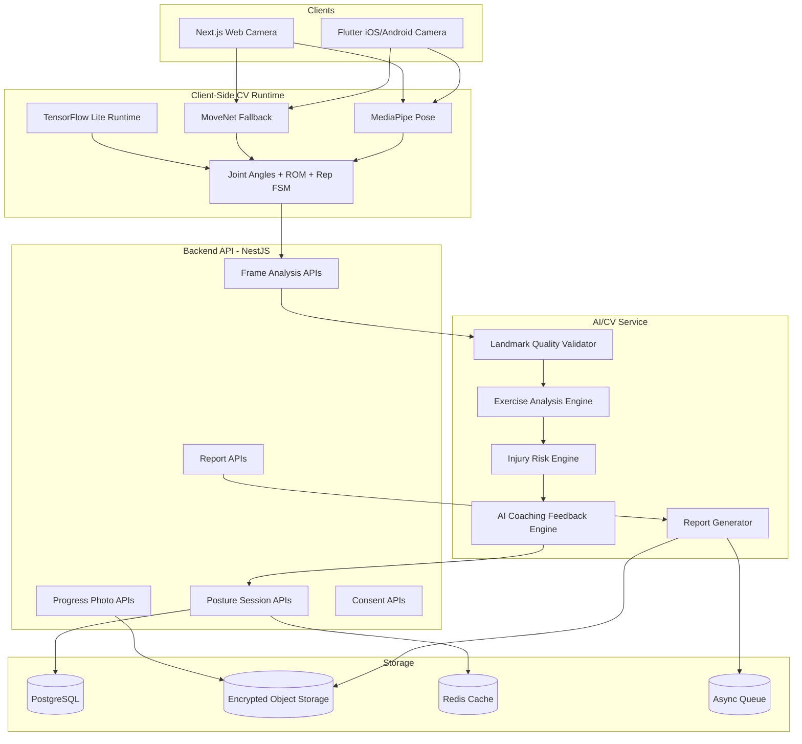
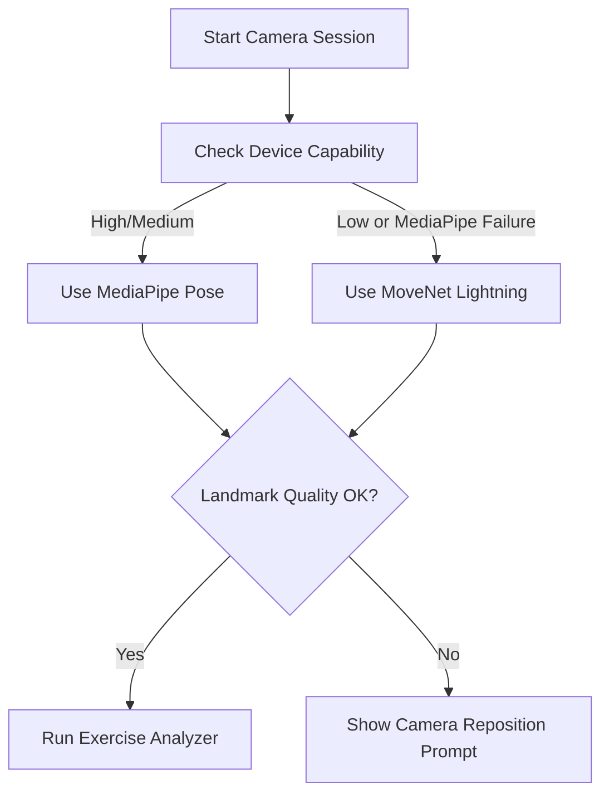
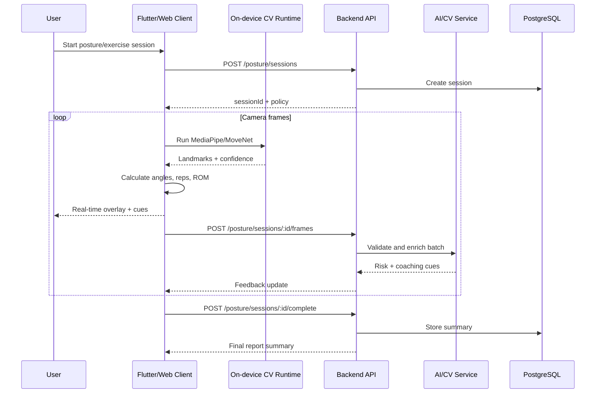
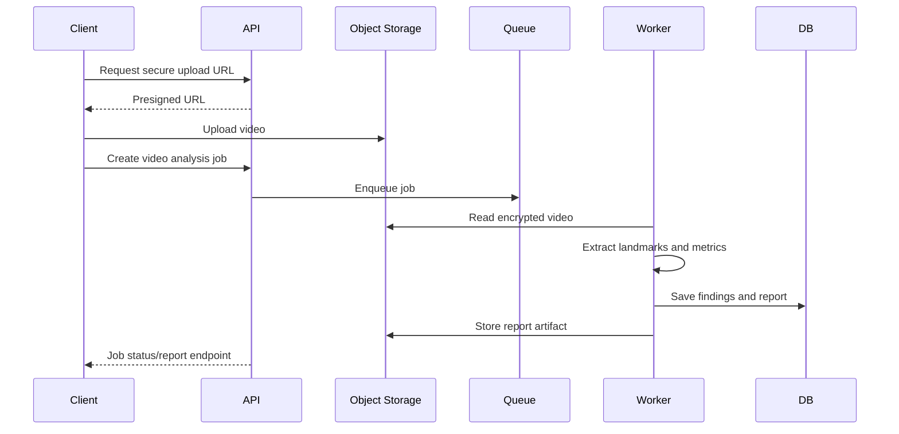
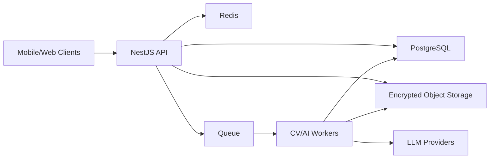

# FITFORGE AI - Phase 6: AI Posture Analysis and Computer Vision System

Status: Phase 6 architecture and implementation roadmap

Approved technology:

- MediaPipe Pose
- MoveNet fallback
- TensorFlow Lite
- Flutter camera integration
- Web camera support
- Backend APIs
- AI coaching feedback

This document defines the production-ready architecture for FITFORGE AI's real-time posture analysis, exercise recognition, rep counting, range-of-motion analysis, injury-risk detection, body measurement tracking, and AI coaching feedback system.

---

## 1. Executive Overview

The AI posture and computer vision system is a hybrid edge-cloud architecture.

Primary design goals:

- Real-time feedback on mobile and web with low latency.
- On-device landmark extraction where possible.
- Server-side validation, report generation, trend analysis, and AI coaching.
- Privacy-first handling of camera frames, videos, and body assessment data.
- Extensible exercise analysis for squat, deadlift, bench press, shoulder press, lunge, and plank.
- Fallback model support for devices that cannot run MediaPipe reliably.

Core principle:

> Raw camera frames should stay on the device by default. Backend services should receive landmarks, derived metrics, and explicit-consent media uploads only.

---

## 2. Capability Scope

### 2.1 Real-Time Posture Analysis

Detect posture and movement quality from live camera input.

Supported real-time outputs:

- Pose landmarks
- Joint angles
- Alignment deviations
- Range of motion
- Stability score
- Repetition count
- Phase detection
- Injury risk score
- Form feedback
- Coaching cues

### 2.2 Exercise Recognition

Recognize or confirm exercise type from movement patterns.

Initial supported exercises:

- Squat
- Deadlift
- Bench press
- Shoulder press
- Lunge
- Plank

Exercise recognition modes:

1. User-selected exercise mode.
2. AI-assisted exercise classification.
3. Trainer-assigned exercise context.

Production recommendation:

- Use user-selected or workout-plan context for MVP reliability.
- Add automatic recognition after enough consented movement samples are collected.

### 2.3 Rep Counting

Rep counting uses exercise-specific finite-state machines.

Examples:

- Squat: standing -> descent -> bottom -> ascent -> standing
- Bench press: lockout -> descent -> bottom -> press -> lockout
- Lunge: standing -> step/descent -> bottom -> return
- Shoulder press: rack -> press -> overhead -> return

### 2.4 Range of Motion Analysis

Measure:

- Hip angle
- Knee angle
- Ankle dorsiflexion
- Shoulder flexion
- Elbow angle
- Trunk lean
- Neck angle
- Pelvic tilt approximation

### 2.5 Injury Risk Detection

Detect risk patterns, not medical diagnoses.

Examples:

- Knee valgus
- Excessive lumbar flexion
- Hip shift
- Asymmetric depth
- Shoulder impingement risk pattern
- Wrist/elbow misalignment
- Neck overextension
- Excessive trunk rotation
- Poor plank spinal alignment

All outputs must include:

- Confidence score
- Safety disclaimer
- Escalation recommendation when confidence is low or risk is high

---

## 3. High-Level Architecture



---

## 4. Runtime Strategy

### 4.1 Client-Side Processing

Client-side processing should perform:

- Camera capture
- Pose landmark extraction
- Landmark smoothing
- Joint angle calculation
- Rep phase detection
- Immediate visual overlays
- Basic form cues
- Frame quality validation

Benefits:

- Low latency
- Lower cloud cost
- Improved privacy
- Offline-friendly behavior
- Reduced bandwidth

### 4.2 Server-Side Processing

Server-side processing should perform:

- Session persistence
- Advanced risk scoring
- Cross-session trend analysis
- AI coaching feedback
- Report generation
- Trainer review workflow
- Audit logging
- Aggregated analytics

### 4.3 Model Fallback Strategy

Primary model:

- MediaPipe Pose

Fallback:

- MoveNet Lightning for low-resource devices
- MoveNet Thunder for higher-accuracy async analysis

Runtime selection:



---

## 5. Component Architecture

### 5.1 Mobile Computer Vision Layer

Flutter modules:

```text
apps/mobile/lib/src/features/posture/
  data/
    posture_api_client.dart
    posture_repository.dart
  domain/
    pose_landmark.dart
    posture_session.dart
    exercise_analysis.dart
    joint_angle.dart
    rep_count_state.dart
  application/
    camera_session_controller.dart
    pose_model_selector.dart
    landmark_smoothing_service.dart
    joint_angle_service.dart
    rep_counter_service.dart
    form_feedback_service.dart
  presentation/
    posture_camera_screen.dart
    pose_overlay_painter.dart
    exercise_feedback_panel.dart
    posture_report_screen.dart
```

Flutter plugins planned:

- `camera`
- `google_mlkit_pose_detection` or custom MediaPipe integration
- `tflite_flutter`
- `permission_handler`
- `path_provider`
- `image`

Mobile real-time loop:

1. Request camera permission.
2. Start camera stream.
3. Run pose model on selected frames.
4. Smooth landmarks.
5. Calculate joint angles.
6. Run exercise analyzer.
7. Render skeleton overlay.
8. Show form cues.
9. Batch landmarks for backend sync.
10. End session and generate report.

### 5.2 Web Computer Vision Layer

Next.js modules:

```text
apps/admin-web/src/features/posture/
  components/
    posture-camera.tsx
    pose-overlay-canvas.tsx
    form-feedback-panel.tsx
    posture-session-summary.tsx
  hooks/
    use-camera-stream.ts
    use-pose-model.ts
    use-posture-session.ts
  lib/
    mediapipe-runtime.ts
    movenet-runtime.ts
    joint-angles.ts
    exercise-analyzers.ts
    rep-counter.ts
```

Web runtime options:

- MediaPipe Tasks Vision for web
- TensorFlow.js MoveNet fallback
- WebAssembly acceleration where supported
- WebGL acceleration where available

Browser requirements:

- HTTPS required for camera access
- Permission prompt with purpose explanation
- Local frame processing by default
- Explicit upload consent before sending media

### 5.3 Backend API Layer

NestJS modules:

```text
services/api/src/modules/posture/
  dto/
    create-posture-session.dto.ts
    analyze-frame.dto.ts
    complete-posture-session.dto.ts
    upload-progress-photo.dto.ts
    body-measurement.dto.ts
  posture.controller.ts
  posture.service.ts
  posture.repository.ts
  posture-report.service.ts
  posture-policy.service.ts

services/api/src/modules/vision/
  vision.controller.ts
  vision.service.ts
  exercise-analysis.service.ts
  joint-angle.service.ts
  injury-risk.service.ts
  rep-counter.service.ts

services/api/src/modules/ai-coaching/
  ai-coaching.controller.ts
  ai-coaching.service.ts
  prompt-orchestrator.service.ts
  safety-filter.service.ts
```

### 5.4 AI/CV Worker Layer

Async worker jobs:

- Generate posture report PDF/JSON
- Process uploaded video
- Extract landmarks from uploaded media
- Compare progress photos
- Generate AI coaching summary
- Notify trainer for high-risk scans
- Aggregate posture analytics

---

## 6. Data Flow

### 6.1 Real-Time Frame Analysis Flow



### 6.2 Uploaded Video Analysis Flow



---

## 7. Backend API Contract

Base path:

```text
/api/v1
```

### 7.1 Posture Session APIs

```text
POST   /posture/sessions
GET    /posture/sessions
GET    /posture/sessions/:sessionId
POST   /posture/sessions/:sessionId/frames
POST   /posture/sessions/:sessionId/complete
POST   /posture/sessions/:sessionId/report
GET    /posture/sessions/:sessionId/report
DELETE /posture/sessions/:sessionId/media
```

#### Create Session

```http
POST /api/v1/posture/sessions
```

Request:

```json
{
  "organizationId": "uuid",
  "branchId": "uuid",
  "memberId": "uuid",
  "capturedBy": "uuid",
  "mode": "exercise_analysis",
  "exerciseType": "squat",
  "source": "mobile_camera",
  "modelPreference": "mediapipe_pose",
  "consent": {
    "landmarkProcessing": true,
    "mediaUpload": false,
    "aiCoaching": true,
    "trainerReview": true
  }
}
```

Response:

```json
{
  "sessionId": "uuid",
  "status": "active",
  "processingPolicy": {
    "uploadRawMedia": false,
    "frameBatchSize": 15,
    "minConfidence": 0.65,
    "allowedModels": ["mediapipe_pose", "movenet_lightning"]
  }
}
```

#### Submit Frame Batch

```http
POST /api/v1/posture/sessions/:sessionId/frames
```

Request:

```json
{
  "model": "mediapipe_pose",
  "modelVersion": "0.10.x",
  "frameRate": 15,
  "frames": [
    {
      "frameIndex": 120,
      "timestampMs": 8000,
      "confidenceScore": 0.91,
      "landmarks": [
        {
          "name": "left_knee",
          "x": 0.42,
          "y": 0.63,
          "z": -0.12,
          "visibility": 0.96
        }
      ],
      "angles": {
        "leftKnee": 92.4,
        "rightKnee": 94.1,
        "hip": 78.2,
        "trunkLean": 12.5
      }
    }
  ]
}
```

Response:

```json
{
  "sessionId": "uuid",
  "repCount": 8,
  "currentPhase": "ascent",
  "riskScore": 22.5,
  "feedback": [
    {
      "severity": "medium",
      "code": "KNEE_VALGUS_LEFT",
      "message": "Drive your left knee outward during ascent.",
      "confidence": 0.84
    }
  ]
}
```

#### Complete Session

```http
POST /api/v1/posture/sessions/:sessionId/complete
```

Request:

```json
{
  "durationSeconds": 420,
  "totalReps": 24,
  "bestRepScore": 92,
  "averageRepScore": 81,
  "clientSummary": {
    "deviceModel": "iPhone",
    "runtime": "mediapipe_pose",
    "rawMediaStored": false
  }
}
```

Response:

```json
{
  "sessionId": "uuid",
  "overallRiskScore": 24.2,
  "overallFormScore": 83.5,
  "summary": "Squat session completed with good depth and minor left knee valgus during fatigue.",
  "nextActions": [
    "Add glute med activation warm-up",
    "Reduce load if knee valgus increases",
    "Re-test in 7 days"
  ]
}
```

### 7.2 Exercise Recognition APIs

```text
POST /vision/exercise-recognition
POST /vision/rep-count
POST /vision/range-of-motion
POST /vision/joint-angles
POST /vision/form-feedback
```

### 7.3 Progress Photo APIs

```text
POST   /body-assessments/progress-photos/upload-url
POST   /body-assessments/progress-photos
GET    /body-assessments/progress-photos
DELETE /body-assessments/progress-photos/:photoId
POST   /body-assessments/compare
```

### 7.4 Body Measurement APIs

```text
POST /body-assessments/measurements
GET  /body-assessments/measurements
GET  /body-assessments/measurements/trends
```

### 7.5 AI Coaching APIs

```text
POST /ai-coaching/posture-feedback
POST /ai-coaching/exercise-feedback
POST /ai-coaching/recovery-recommendation
POST /ai-coaching/progress-summary
```

---

## 8. Data Models

### 8.1 `posture_sessions`

| Field | Type | Description |
|---|---|---|
| `id` | UUID | Session ID |
| `organization_id` | UUID | Tenant |
| `branch_id` | UUID nullable | Branch |
| `member_id` | UUID | Member being assessed |
| `captured_by` | UUID nullable | Member or trainer |
| `mode` | enum | `posture_scan`, `exercise_analysis`, `body_assessment` |
| `exercise_type` | enum nullable | Squat, deadlift, bench press, etc. |
| `source` | enum | `mobile_camera`, `web_camera`, `uploaded_video`, `progress_photo` |
| `model_primary` | varchar | MediaPipe Pose |
| `model_fallback` | varchar nullable | MoveNet |
| `model_version` | varchar | Runtime version |
| `status` | enum | `active`, `processing`, `completed`, `failed`, `cancelled` |
| `overall_form_score` | numeric | 0-100 |
| `overall_risk_score` | numeric | 0-100 |
| `confidence_score` | numeric | 0-100 |
| `total_reps` | integer | Counted reps |
| `duration_seconds` | integer | Session duration |
| `summary` | text | AI/CV summary |
| `consent_snapshot` | jsonb | Consent at capture time |
| `created_at` | timestamptz | Created time |
| `completed_at` | timestamptz nullable | Completed time |

### 8.2 `pose_frame_batches`

| Field | Type | Description |
|---|---|---|
| `id` | UUID | Batch ID |
| `posture_session_id` | UUID | Session |
| `batch_index` | integer | Batch sequence |
| `frame_start_ms` | integer | Start timestamp |
| `frame_end_ms` | integer | End timestamp |
| `model_name` | varchar | MediaPipe/MoveNet |
| `frame_count` | integer | Number of frames |
| `quality_score` | numeric | Batch quality |
| `landmarks_summary` | jsonb | Compressed landmarks or statistical summary |
| `angles_summary` | jsonb | Joint angles |
| `created_at` | timestamptz | Created time |

Storage note:

- Full frame-level landmarks should be retained only if needed for session replay/debugging and approved by consent.
- Default retention should store compressed summaries and final metrics.

### 8.3 `exercise_rep_metrics`

| Field | Type | Description |
|---|---|---|
| `id` | UUID | Rep metric ID |
| `posture_session_id` | UUID | Session |
| `rep_number` | integer | Rep number |
| `exercise_type` | enum | Exercise |
| `form_score` | numeric | 0-100 |
| `risk_score` | numeric | 0-100 |
| `rom_score` | numeric | 0-100 |
| `tempo_seconds` | numeric | Rep duration |
| `phase_metrics` | jsonb | Descent/ascent/hold details |
| `joint_angles` | jsonb | Min/max angle values |
| `feedback_codes` | text[] | Feedback identifiers |

### 8.4 `posture_findings`

| Field | Type | Description |
|---|---|---|
| `id` | UUID | Finding ID |
| `posture_session_id` | UUID | Session |
| `finding_type` | varchar | Knee valgus, lumbar flexion, etc. |
| `severity` | enum | Low, medium, high, critical |
| `confidence_score` | numeric | 0-100 |
| `risk_score` | numeric | 0-100 |
| `observations` | text | Explanation |
| `corrective_exercises` | jsonb | Corrective plan |
| `mobility_recommendations` | jsonb | Mobility plan |
| `created_at` | timestamptz | Created time |

### 8.5 `progress_photos`

| Field | Type | Description |
|---|---|---|
| `id` | UUID | Photo ID |
| `organization_id` | UUID | Tenant |
| `branch_id` | UUID nullable | Branch |
| `member_id` | UUID | Member |
| `captured_by` | UUID nullable | Actor |
| `view_type` | enum | `front`, `side`, `back`, `custom` |
| `object_key` | text | Encrypted storage path |
| `thumbnail_key` | text | Thumbnail path |
| `consent_snapshot` | jsonb | Consent |
| `metadata` | jsonb | Device/camera metadata |
| `created_at` | timestamptz | Created time |

### 8.6 `body_measurements`

| Field | Type | Description |
|---|---|---|
| `id` | UUID | Measurement ID |
| `organization_id` | UUID | Tenant |
| `branch_id` | UUID nullable | Branch |
| `member_id` | UUID | Member |
| `source` | enum | `manual`, `ai_estimated`, `trainer_measured`, `device_import` |
| `weight_kg` | numeric nullable | Weight |
| `body_fat_percent` | numeric nullable | Body fat estimate |
| `chest_cm` | numeric nullable | Chest |
| `waist_cm` | numeric nullable | Waist |
| `hips_cm` | numeric nullable | Hips |
| `left_arm_cm` | numeric nullable | Left arm |
| `right_arm_cm` | numeric nullable | Right arm |
| `left_thigh_cm` | numeric nullable | Left thigh |
| `right_thigh_cm` | numeric nullable | Right thigh |
| `measurement_confidence` | numeric nullable | AI/manual confidence |
| `recorded_at` | timestamptz | Measurement time |

---

## 9. Joint Angle Calculations

### 9.1 Angle Formula

For three landmarks A, B, C where B is the joint:

```text
angle = arccos(((A-B) dot (C-B)) / (|A-B| * |C-B|))
```

Implementation rules:

- Use normalized coordinates for relative angles.
- Use world coordinates where available for depth-aware analysis.
- Reject calculations when landmark visibility is below threshold.
- Smooth angle streams using exponential moving average.
- Keep raw and smoothed values separate for debugging.

### 9.2 Key Angles

| Metric | Landmarks |
|---|---|
| Knee angle | Hip, knee, ankle |
| Hip angle | Shoulder, hip, knee |
| Elbow angle | Shoulder, elbow, wrist |
| Shoulder angle | Hip, shoulder, elbow |
| Ankle dorsiflexion | Knee, ankle, toe/foot index |
| Trunk lean | Shoulder midpoint, hip midpoint, vertical axis |
| Neck angle | Ear, shoulder, hip |
| Pelvic tilt approximation | Hip landmarks and torso reference |

---

## 10. Exercise Analysis Rules

### 10.1 Squat Analysis

Signals:

- Hip depth
- Knee flexion
- Ankle dorsiflexion
- Trunk lean
- Knee tracking over toes
- Left/right symmetry
- Hip shift

Feedback examples:

- `SQUAT_DEPTH_INSUFFICIENT`
- `KNEE_VALGUS_LEFT`
- `KNEE_VALGUS_RIGHT`
- `EXCESSIVE_FORWARD_LEAN`
- `ASYMMETRIC_HIP_SHIFT`
- `HEEL_RISE`

### 10.2 Deadlift Analysis

Signals:

- Hip hinge pattern
- Neutral spine proxy
- Shoulder-bar alignment proxy
- Knee extension timing
- Hip extension timing
- Bar path approximation when visible

Feedback examples:

- `DEADLIFT_ROUNDED_BACK_RISK`
- `HIPS_RISING_TOO_FAST`
- `EXCESSIVE_SQUAT_PATTERN`
- `LOCKOUT_OVEREXTENSION`

### 10.3 Bench Press Analysis

Signals:

- Elbow angle
- Shoulder angle
- Wrist-elbow alignment
- Bar/hand path approximation
- Left/right symmetry
- Range of motion

Feedback examples:

- `BENCH_FLARED_ELBOWS`
- `BENCH_PARTIAL_ROM`
- `BENCH_WRIST_STACKING`
- `BENCH_ASYMMETRIC_PRESS`

### 10.4 Shoulder Press Analysis

Signals:

- Shoulder flexion
- Elbow extension
- Wrist stacking
- Lumbar extension proxy
- Lockout symmetry

Feedback examples:

- `PRESS_EXCESSIVE_BACK_ARCH`
- `PRESS_FORWARD_BAR_PATH`
- `PRESS_INCOMPLETE_LOCKOUT`
- `PRESS_ASYMMETRIC_LOCKOUT`

### 10.5 Lunge Analysis

Signals:

- Front knee tracking
- Rear knee depth
- Trunk stability
- Step length
- Hip/knee symmetry

Feedback examples:

- `LUNGE_KNEE_VALGUS`
- `LUNGE_SHORT_STEP`
- `LUNGE_TRUNK_COLLAPSE`
- `LUNGE_DEPTH_INSUFFICIENT`

### 10.6 Plank Analysis

Signals:

- Shoulder-hip-ankle alignment
- Hip sag
- Hip pike
- Neck position
- Hold duration

Feedback examples:

- `PLANK_HIP_SAG`
- `PLANK_HIP_PIKE`
- `PLANK_NECK_EXTENSION`
- `PLANK_SHOULDER_SHIFT`

---

## 11. AI Coaching Feedback

### 11.1 Coaching Engine Inputs

- Exercise type
- Rep metrics
- Form feedback codes
- User goals
- Training age
- Injury flags provided by user
- Trainer notes
- Session history
- Current workout program

### 11.2 Coaching Output

```json
{
  "summary": "Your squat depth was consistent, but left knee valgus increased after rep 8.",
  "priorityFixes": [
    {
      "title": "Improve left knee tracking",
      "reason": "Valgus increased during fatigue",
      "cue": "Push the floor apart and keep your knee aligned with your second toe"
    }
  ],
  "correctiveExercises": [
    {
      "name": "Banded lateral walks",
      "sets": 2,
      "reps": "12 each side"
    }
  ],
  "safetyNotice": "This feedback is educational and not a medical diagnosis."
}
```

### 11.3 AI Safety Rules

The AI coaching layer must not:

- Diagnose injuries.
- Override medical advice.
- Recommend training through acute pain.
- Provide unsafe load increases.
- Infer protected health information.

The AI coaching layer must:

- Include disclaimers for posture/body scan outputs.
- Recommend professional evaluation for high-risk patterns.
- Escalate to trainer review when confidence is low.
- Keep advice within fitness coaching boundaries.

---

## 12. Storage Strategy

### 12.1 Default Storage Policy

Store by default:

- Session metadata
- Landmark summaries
- Joint angle summaries
- Rep metrics
- Feedback codes
- Report JSON
- AI coaching summary

Do not store by default:

- Raw camera frames
- Raw video
- Full-resolution progress photos without consent

### 12.2 Object Storage

Use encrypted object storage for:

- Progress photos
- Uploaded analysis videos
- Generated reports
- Thumbnails

Recommended object key pattern:

```text
organizations/{organizationId}/members/{memberId}/posture/{sessionId}/report.json
organizations/{organizationId}/members/{memberId}/progress-photos/{photoId}/front.jpg
```

### 12.3 Retention

Recommended defaults:

| Data Type | Default Retention |
|---|---|
| Session summaries | Account lifetime |
| Landmark summaries | 24 months |
| Full landmarks | 90 days if enabled |
| Raw videos | 30 days if enabled |
| Progress photos | Account lifetime or user deletion |
| Audit logs | 7 years |

Tenant policies may shorten retention based on compliance requirements.

---

## 13. Security and Privacy Controls

### 13.1 Consent Controls

Require explicit consent for:

- Camera access
- Landmark processing
- AI coaching
- Progress photo storage
- Raw media upload
- Trainer review
- Research/model improvement usage

Consent must be versioned and stored as a snapshot per session.

### 13.2 Access Control

RBAC rules:

- Member can access own scans and progress photos.
- Trainer can access assigned clients only.
- Fitness manager can access branch-level summaries and assigned oversight areas.
- Receptionist has no access to posture media by default.
- Admin can access tenant data based on audit-controlled permissions.
- Super admin access must be break-glass or support-scoped.

### 13.3 Encryption

Required:

- TLS for all API traffic.
- KMS encryption for object storage.
- PostgreSQL encryption at rest.
- Signed URLs for media access.
- Short-lived upload/download URLs.
- Optional application-level encryption for sensitive media metadata.

### 13.4 Privacy by Design

Controls:

- Process frames locally where possible.
- Upload landmarks instead of video by default.
- Redact face region for progress photos where feasible.
- Allow users to delete progress photos.
- Allow users to export posture reports.
- Log all sensitive report access.
- Disable model training usage unless explicitly opted in.

### 13.5 Audit Events

Audit:

- Session creation
- Report generation
- Report access
- Media upload
- Media download
- Media deletion
- Trainer review
- Consent changes
- High-risk alert access
- Data export/deletion

---

## 14. Production Deployment Plan

### 14.1 Services



### 14.2 Deployment Units

Backend API:

- Dockerized NestJS service
- Horizontal autoscaling
- Public API behind WAF and load balancer

AI/CV workers:

- Dockerized worker service
- CPU worker pool for reports and metrics
- Optional GPU worker pool for video reprocessing

Storage:

- PostgreSQL for relational data
- Redis for session state, active analysis cache, and rate limits
- Object storage for photos, videos, and reports

### 14.3 Observability

Metrics:

- Frame batch latency
- Session completion rate
- Model fallback rate
- Landmark quality score
- AI feedback latency
- Report generation duration
- Media upload size
- High-risk finding count
- Error rate by device/platform

Logs:

- Request ID
- Session ID
- Model name/version
- Client platform
- Processing status
- Failure reason

Alerts:

- Elevated frame processing errors
- Spike in model fallback
- Report generation backlog
- Media upload failures
- High-risk scan notification failures

---

## 15. Client UX Requirements

### 15.1 Camera Setup

Before scan:

- Explain camera purpose.
- Show privacy notice.
- Ask for consent.
- Guide user positioning.
- Verify full body visibility.
- Validate lighting and camera angle.

During scan:

- Draw skeleton overlay.
- Display rep count.
- Display current phase.
- Show one primary correction cue at a time.
- Use color-coded feedback.
- Avoid overwhelming the user.

After scan:

- Show form score.
- Show risk score.
- Show top findings.
- Show corrective exercises.
- Show trend comparison.
- Offer trainer review.

### 15.2 Accessibility

Support:

- Voice cues.
- Haptic cues on mobile.
- Large readable feedback.
- Reduced motion mode.
- High contrast overlays.
- Captions for coaching videos.

---

## 16. Production Implementation Roadmap

### Milestone 1 - Foundation

Deliver:

- Posture session APIs
- Consent model
- Data models and migrations
- Basic report schema
- Mobile/web camera permission UX
- MediaPipe Pose runtime proof of concept
- MoveNet fallback proof of concept

Exit criteria:

- Create, stream, complete, and retrieve posture sessions.
- Process landmarks without storing raw media.
- Generate basic joint angles.

### Milestone 2 - Real-Time Analysis

Deliver:

- Landmark smoothing
- Joint angle engine
- Range-of-motion calculations
- Rep counting state machines
- Real-time feedback overlay
- Client-side batch sync

Exit criteria:

- Count reps for squat and plank with acceptable test accuracy.
- Show real-time cues under target latency.

### Milestone 3 - Exercise-Specific Analyzers

Deliver:

- Squat analyzer
- Deadlift analyzer
- Bench press analyzer
- Shoulder press analyzer
- Lunge analyzer
- Plank analyzer
- Exercise-specific feedback codes

Exit criteria:

- Each analyzer returns form score, risk score, ROM score, and feedback codes.

### Milestone 4 - AI Coaching and Reports

Deliver:

- AI coaching prompt orchestration
- Safety filter
- Corrective exercise recommendations
- Report generation
- Trainer review workflow
- Member-facing history

Exit criteria:

- Completed session generates a safe, useful coaching summary and corrective plan.

### Milestone 5 - Progress Photos and Body Measurements

Deliver:

- Secure progress photo upload
- Front/side/back classification
- Measurement entry and trend APIs
- Optional AI-estimated measurements
- Progress comparison reports

Exit criteria:

- Members can securely store and compare progress photos and measurements.

### Milestone 6 - Production Hardening

Deliver:

- Load testing
- Latency monitoring
- Audit logging
- Retention policies
- Data export/deletion
- Security review
- Model drift monitoring
- Device compatibility matrix

Exit criteria:

- System is ready for staged rollout across selected branches.

---

## 17. Test Strategy

### 17.1 Unit Tests

Test:

- Joint angle calculations
- Landmark confidence filtering
- Landmark smoothing
- Rep state machines
- Feedback code generation
- Risk score calculation
- Consent policy enforcement

### 17.2 Integration Tests

Test:

- Create session -> submit frames -> complete session.
- Upload progress photo -> generate signed URL -> retrieve report.
- AI coaching safety filter.
- RBAC access for member/trainer/manager/admin.

### 17.3 Computer Vision Evaluation

Use curated test clips:

- Good squat
- Knee valgus squat
- Partial depth squat
- Rounded-back deadlift
- Bench asymmetry
- Plank hip sag

Metrics:

- Rep counting accuracy
- Exercise phase accuracy
- Feedback precision
- Feedback recall
- False high-risk alert rate

### 17.4 Device Testing

Matrix:

- iOS high-end
- iOS mid-range
- Android high-end
- Android mid-range
- Android low-resource
- Desktop Chrome
- Desktop Safari
- Desktop Edge

---

## 18. Engineering Risks and Mitigations

| Risk | Impact | Mitigation |
|---|---:|---|
| Poor landmark quality | High | Camera setup checks, confidence thresholds, reposition prompts |
| False injury-risk alerts | High | Confidence scoring, conservative language, trainer escalation |
| High mobile CPU usage | Medium | Frame throttling, model fallback, adaptive quality |
| Privacy concerns | High | Local processing, consent snapshots, media upload opt-in |
| Browser compatibility issues | Medium | MediaPipe primary, MoveNet fallback, compatibility matrix |
| Rep counting edge cases | Medium | Exercise-specific FSMs, calibration reps, user-selected exercise mode |
| AI unsafe advice | High | Safety filter, bounded prompts, no diagnosis policy |
| Storage cost growth | Medium | Retention policies, summaries by default, media lifecycle rules |

---

## 19. Phase 6 Approval Gate

Before implementation begins, confirm:

- Whether raw video upload is allowed for any production workflows.
- Default retention period for landmarks and progress photos.
- Whether AI-estimated body measurements are enabled at launch or deferred.
- Whether automatic exercise recognition is required for MVP or can follow after user-selected exercise mode.
- Which roles can access posture reports and progress photos.
- Whether trainer review is mandatory for high-risk scans.

Recommended MVP scope:

1. MediaPipe Pose on mobile/web.
2. MoveNet fallback.
3. Squat and plank real-time analysis.
4. Joint angle calculations.
5. Rep counting.
6. Basic risk scoring.
7. Consent-backed session storage.
8. AI coaching summary.
9. Progress photo upload.
10. Trainer review for high-risk reports.
