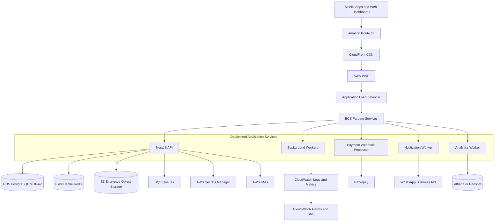
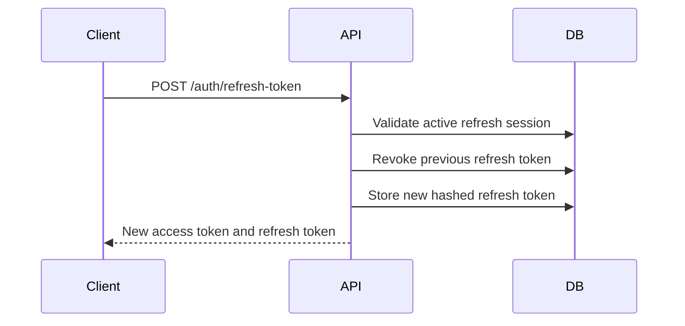
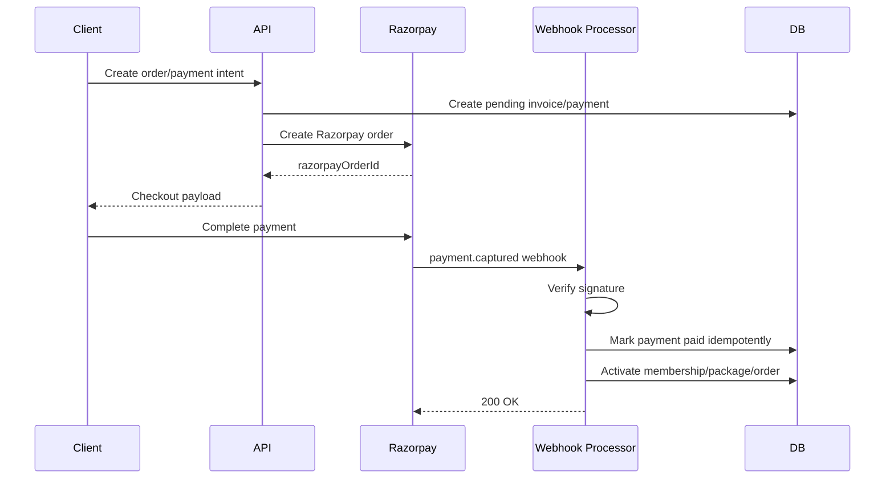
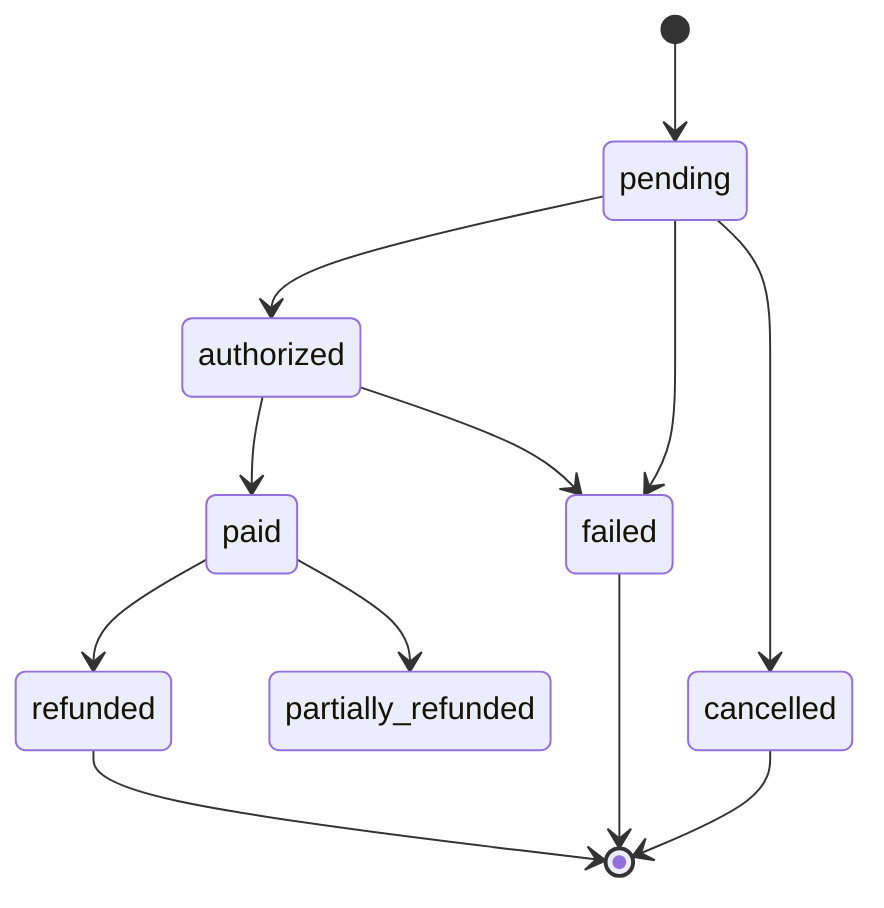
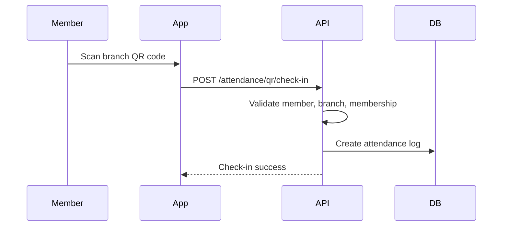
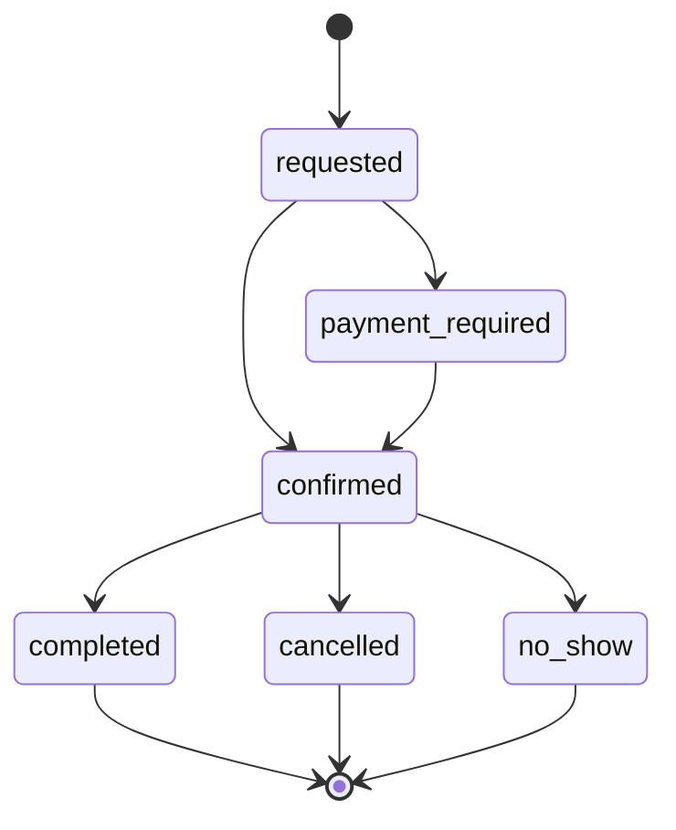
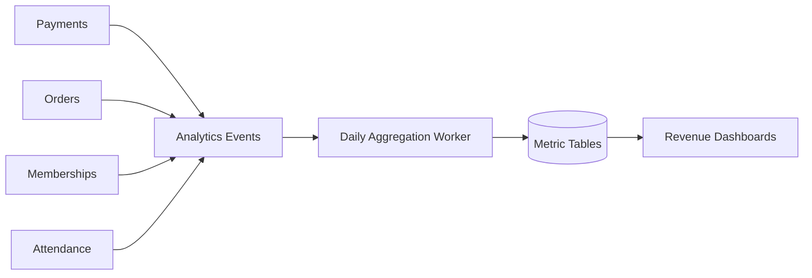
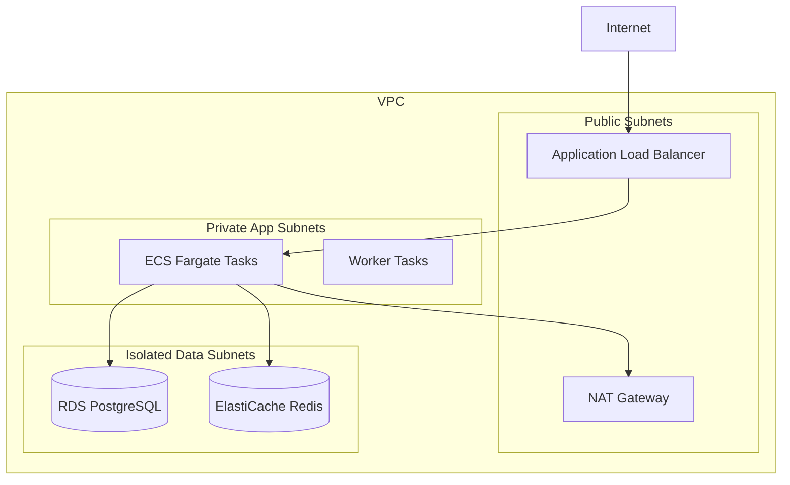

# FITFORGE AI - Phase 7: Production Deployment, Security, Payments, and Commercial Readiness

Status: Phase 7 production-readiness architecture and implementation roadmap

This document defines the production deployment, security, payments, operations, and commercial readiness plan for FITFORGE AI.

Scope:

- Security architecture and OWASP readiness
- Razorpay and subscription payment flows
- AWS production infrastructure
- Docker and CI/CD strategy
- Monitoring, logging, backups, and disaster recovery
- Commercial launch capabilities
- Production checklist

---

## 1. Executive Production Readiness Summary

FITFORGE AI requires an enterprise-grade production foundation that can safely operate:

- Multi-branch gym management
- Membership billing and renewals
- Personal trainer package sales
- Product and supplement purchases
- QR attendance
- Trainer bookings
- WhatsApp notifications
- Revenue analytics
- Franchise operations

The recommended production model is:

- AWS-hosted containerized backend
- PostgreSQL as primary transactional database
- Redis for caching, sessions, queues, and rate limits
- Object storage for media and reports
- WAF-protected public APIs
- CI/CD through GitHub Actions
- Strong authentication and RBAC
- Full audit logging
- Payment provider webhook hardening
- Encrypted data at rest and in transit
- Backup and disaster recovery procedures

---

## 2. Production Architecture Overview



---

## 3. Security Architecture

### 3.1 Authentication

Required controls:

- JWT access tokens
- Refresh tokens with rotation
- Hashed refresh tokens stored server-side
- Short-lived access tokens
- Device-bound session metadata
- Logout and revoke-all-sessions support
- Account lockout after repeated failures
- MFA for admin, franchise, and owner roles

Recommended token lifetimes:

| Token | Lifetime | Storage |
|---|---:|---|
| Access token | 15 minutes | Memory or secure storage |
| Refresh token | 30 days | Secure HTTP-only cookie on web, secure storage on mobile |
| Password reset token | 15 minutes | Hashed server-side |
| Email verification token | 24 hours | Hashed server-side |

### 3.2 Refresh Token Rotation



Security rules:

- Store only refresh token hashes.
- Revoke previous token on each refresh.
- Detect token reuse and revoke the session family.
- Track device, IP, user agent, and last used timestamp.
- Audit refresh token reuse attempts.

### 3.3 RBAC

Required roles:

- Super Admin
- Admin
- Franchise Owner
- Gym Owner
- Branch Manager
- Fitness Manager
- Trainer
- Receptionist
- Member
- Vendor

Permission model:

```text
user -> user_roles -> roles -> role_permissions -> permissions
user -> branch_access -> branch -> organization
```

Access must be scoped by:

- Organization
- Branch
- Role
- Permission
- Assignment relationship
- Resource ownership

Examples:

| Action | Required Permission | Scope Rule |
|---|---|---|
| Renew membership | `memberships.renew` | Same branch |
| View trainer client | `clients.read` | Assigned trainer |
| View revenue analytics | `analytics.revenue.read` | Owner/admin/franchise scope |
| Adjust inventory | `inventory.adjust` | Branch inventory scope |
| View audit logs | `audit.read` | Admin or super admin |

### 3.4 Audit Logs

Audit log requirements:

- Append-only
- Immutable from application layer
- Searchable by actor, entity, action, branch, organization, and date
- Redacted sensitive fields
- Retained based on compliance policy

Audit these actions:

- Login success/failure
- Token refresh reuse
- Password changes
- Role and permission changes
- Branch access changes
- Membership creation, renewal, pause, cancellation
- Payment creation, success, failure, refund
- Razorpay webhook received and processed
- Manual attendance edits
- Trainer booking creation/cancellation
- Inventory adjustment
- Product price changes
- Revenue report exports
- Data export and deletion requests

### 3.5 Encryption at Rest

Required:

- RDS PostgreSQL encrypted with AWS KMS
- ElastiCache encryption at rest
- S3 server-side encryption with KMS
- Encrypted EBS volumes for build/deployment infrastructure
- Secrets stored in AWS Secrets Manager
- Backups encrypted with KMS

Application-level encryption should be considered for:

- MFA secrets
- Health-adjacent notes
- Body scan metadata
- Biometric integration identifiers
- Payment provider metadata that may contain sensitive references

### 3.6 Encryption in Transit

Required:

- TLS 1.2+ for all public traffic
- HTTPS enforced by CloudFront and ALB
- HSTS headers
- TLS for database connections
- TLS for Redis connections
- TLS for third-party integrations
- Signed URLs for private media

### 3.7 OWASP Security Review

OWASP Top 10 controls:

| OWASP Risk | FITFORGE Control |
|---|---|
| Broken Access Control | RBAC guards, tenant scoping, ownership checks |
| Cryptographic Failures | KMS, TLS, token hashing, encrypted backups |
| Injection | Prisma parameterized queries, validation pipes |
| Insecure Design | Threat modeling, secure payment state machines |
| Security Misconfiguration | IaC templates, least privilege IAM, hardened containers |
| Vulnerable Components | Dependency scanning, SBOM, patch process |
| Authentication Failures | MFA, refresh rotation, lockouts |
| Software/Data Integrity Failures | Signed builds, protected branches, CI checks |
| Logging/Monitoring Failures | CloudWatch, audit logs, alerts |
| SSRF | URL allowlists, metadata endpoint blocking |

Additional testing:

- API penetration test
- RBAC bypass testing
- Webhook replay testing
- Multi-tenant isolation testing
- Rate-limit testing
- File upload security testing
- Dependency vulnerability review

---

## 4. Payment Architecture

### 4.1 Payment Provider

Primary India payment provider:

- Razorpay

Future providers:

- Stripe
- PayPal

Payment domains:

- Subscription billing
- Membership renewals
- Personal trainer package payments
- Product and supplement purchases
- Refunds
- Coupons and discounts
- Invoices and receipts

### 4.2 Payment Flow Overview



### 4.3 Razorpay Integration

Required backend endpoints:

```text
POST /payments/razorpay/orders
POST /payments/razorpay/webhook
GET  /payments/:paymentId
POST /payments/:paymentId/refund
```

Required environment secrets:

```text
RAZORPAY_KEY_ID
RAZORPAY_KEY_SECRET
RAZORPAY_WEBHOOK_SECRET
```

Webhook security:

- Verify Razorpay signature.
- Reject unsigned webhooks.
- Store webhook event ID.
- Enforce idempotency by provider event ID.
- Process webhook asynchronously after durable write.
- Return 2xx only after durable event receipt.
- Alert on signature failures.

### 4.4 Payment State Machine



Rules:

- Business entitlements activate only after `paid`.
- Payment webhook must be idempotent.
- Payment amount and currency must match invoice/order.
- Refunds must create audit logs.
- Manual payment override requires privileged permission.

### 4.5 Subscription Billing

Subscription entities:

- `subscription_plans`
- `subscriptions`
- `subscription_invoices`
- `payments`
- `payment_methods`

Subscription events:

- Created
- Trial started
- Trial ended
- Invoice generated
- Payment successful
- Payment failed
- Grace period started
- Cancelled
- Renewed

### 4.6 Membership Renewals

Renewal channels:

- Member self-renewal
- Reception-assisted renewal
- Auto-renewal
- Admin renewal adjustment

Renewal workflow:

1. Identify expiring membership.
2. Notify member over app, email, SMS, or WhatsApp.
3. Generate renewal invoice.
4. Collect payment through Razorpay.
5. Process webhook.
6. Extend membership end date.
7. Generate receipt.
8. Audit the renewal.

### 4.7 Personal Trainer Package Payments

Package examples:

- 4-session PT pack
- 8-session PT pack
- Monthly personal training
- Transformation coaching plan

Rules:

- PT package must define session count, expiry, trainer assignment rules, cancellation rules, and refund policy.
- Package entitlement activates after paid webhook.
- Each booked PT session decrements available package credits.
- Trainer commission can be calculated after completed sessions.

### 4.8 Product Purchases

Product categories:

- Apparel
- Footwear
- Accessories
- Equipment
- Supplements

Order workflow:

1. Cart checkout.
2. Inventory reservation.
3. Razorpay order creation.
4. Payment completion.
5. Webhook confirmation.
6. Inventory decrement.
7. Fulfillment workflow.
8. Receipt and notification.

Inventory rules:

- Reserve stock before checkout.
- Release reservation on payment timeout.
- Deduct stock only after successful payment.
- Support branch pickup and delivery workflows.

---

## 5. Commercial Features

### 5.1 QR Code Attendance

Architecture:



Security rules:

- QR code should be signed.
- QR token should rotate frequently.
- Branch QR must include branch ID and nonce.
- Reject expired QR tokens.
- Prevent duplicate check-ins within configurable window.
- Audit manual overrides.

### 5.2 Multi-Branch Management

Capabilities:

- Organization-level dashboard
- Branch-level dashboard
- Staff assignment per branch
- Shared/global membership plans
- Branch-specific membership plans
- Branch-specific inventory
- Cross-branch attendance policy
- Branch revenue and churn analytics

Tenant isolation:

- All queries scoped by `organization_id`.
- Branch operations scoped by `branch_id`.
- Franchise roles can access assigned branch groups only.

### 5.3 Trainer Booking

Capabilities:

- Trainer availability calendar
- Booking slots
- PT package credit application
- Paid ad-hoc sessions
- Cancellation and rescheduling policy
- Trainer commission tracking
- Member reminders
- Trainer notifications

Booking state machine:



### 5.4 WhatsApp Notifications

Use cases:

- Membership renewal reminders
- Payment receipt
- PT booking confirmation
- Attendance milestone
- Workout reminders
- Lead follow-up
- High-risk posture scan trainer alert

Requirements:

- WhatsApp Business API provider
- Template approval workflow
- Opt-in and opt-out management
- Delivery status tracking
- Message audit log
- Rate limiting

Recommended providers:

- Meta WhatsApp Cloud API
- Twilio
- Gupshup
- Interakt

### 5.5 Revenue Analytics

Dashboards:

- Revenue by branch
- Revenue by membership plan
- Renewal revenue
- PT package revenue
- Product sales revenue
- Supplement revenue
- Refunds
- Outstanding invoices
- Churn impact
- Trainer commission
- Franchise royalty calculations

Data pipeline:



### 5.6 Franchise Support

Capabilities:

- Franchise parent organization
- Multiple branch groups
- Regional manager roles
- Branch benchmarking
- Revenue rollups
- Royalty reporting
- Standardized plans and campaigns
- Shared product catalog
- Franchise-wide announcements

---

## 6. AWS Infrastructure Architecture

### 6.1 Network Design

Recommended VPC:

- Public subnets for ALB and NAT Gateway
- Private subnets for ECS tasks
- Isolated private subnets for RDS and Redis
- Multi-AZ deployment
- VPC endpoints for S3, ECR, CloudWatch, Secrets Manager where practical



### 6.2 Core AWS Services

| Domain | AWS Service |
|---|---|
| DNS | Route 53 |
| CDN | CloudFront |
| WAF | AWS WAF |
| Containers | ECS Fargate |
| Images | ECR |
| Database | RDS PostgreSQL Multi-AZ |
| Cache | ElastiCache Redis |
| Object storage | S3 |
| Queue | SQS |
| Secrets | Secrets Manager |
| Encryption | KMS |
| Logs | CloudWatch Logs |
| Metrics | CloudWatch Metrics |
| Alerts | CloudWatch Alarms + SNS |
| Analytics | Athena or Redshift |
| Backups | AWS Backup |

### 6.3 Environment Strategy

Environments:

- Development
- Staging
- Production

Rules:

- Separate AWS accounts preferred for staging and production.
- Separate databases per environment.
- Separate Razorpay keys per environment.
- Production secrets never shared with lower environments.
- Staging should mirror production topology at smaller scale.

---

## 7. Docker Strategy

### 7.1 Image Types

Images:

- `fitforge-api`
- `fitforge-worker`
- `fitforge-admin-web`
- `fitforge-migration-runner`

Image requirements:

- Non-root user
- Minimal base image
- Multi-stage builds
- No secrets baked into images
- Health check endpoint
- SBOM generation
- Vulnerability scan in CI

### 7.2 Runtime Environment Variables

Backend:

```text
NODE_ENV=production
DATABASE_URL
REDIS_URL
JWT_ACCESS_SECRET
JWT_REFRESH_SECRET
RAZORPAY_KEY_ID
RAZORPAY_KEY_SECRET
RAZORPAY_WEBHOOK_SECRET
WHATSAPP_PROVIDER
WHATSAPP_ACCESS_TOKEN
AWS_REGION
S3_BUCKET_PRIVATE
```

Web:

```text
NEXT_PUBLIC_API_BASE_URL
NEXT_PUBLIC_APP_NAME
```

---

## 8. CI/CD Pipeline

### 8.1 GitHub Actions Pipeline

```mermaid
flowchart LR
    PR[Pull Request] --> Lint[Lint]
    Lint --> Test[Unit and Integration Tests]
    Test --> Typecheck[Typecheck]
    Typecheck --> Security[Dependency and Container Scan]
    Security --> Build[Build Docker Images]
    Build --> Push[ECR Push]
    Push --> DeployStaging[Deploy Staging]
    DeployStaging --> Smoke[Smoke Tests]
    Smoke --> Approval[Production Approval]
    Approval --> DeployProd[Deploy Production]
```



### 8.2 Required Checks

Backend:

- Install dependencies
- Typecheck
- Lint
- Unit tests
- Prisma schema validation
- Migration dry run
- Build Docker image
- Vulnerability scan

Web:

- Typecheck
- Lint
- Production build
- Bundle size check

Mobile:

- Flutter analyze
- Flutter test
- Android build
- iOS build on macOS runner

Infrastructure:

- Terraform fmt
- Terraform validate
- Terraform plan
- Policy checks

### 8.3 Deployment Sequence

Staging:

1. Build images.
2. Push images to ECR.
3. Run database migrations.
4. Deploy ECS services.
5. Run smoke tests.
6. Run payment sandbox webhook test.
7. Run QR attendance smoke test.

Production:

1. Confirm release approval.
2. Create database backup snapshot.
3. Deploy migrations with expand-contract strategy.
4. Deploy API workers first if backward-compatible.
5. Deploy API service.
6. Deploy web dashboard.
7. Run health checks.
8. Verify Razorpay webhook delivery.
9. Monitor error rates.

---

## 9. Monitoring and Logging

### 9.1 Application Monitoring

Metrics:

- API latency p50/p95/p99
- Error rate by endpoint
- Auth failures
- Refresh token reuse attempts
- Payment webhook failures
- Razorpay order creation failures
- Membership renewal failures
- QR check-in failures
- WhatsApp delivery failures
- Background job queue depth
- Database connection pool usage
- Redis latency

### 9.2 Business Monitoring

Metrics:

- Active memberships
- Renewals due
- Renewal conversion
- Daily revenue
- PT package sales
- Product purchases
- Attendance count
- Trainer booking utilization
- Franchise branch performance
- Refund rate

### 9.3 Logging

Required structured log fields:

- `timestamp`
- `level`
- `requestId`
- `userId`
- `organizationId`
- `branchId`
- `role`
- `action`
- `entityType`
- `entityId`
- `latencyMs`
- `statusCode`
- `errorCode`

Do not log:

- Passwords
- Access tokens
- Refresh tokens
- Payment secrets
- Full card details
- MFA secrets
- Sensitive body scan media

### 9.4 Alerting

Critical alerts:

- API 5xx rate above threshold
- Payment webhook failure spike
- Database CPU/storage critical
- Redis unavailable
- Queue backlog above threshold
- Unauthorized access spike
- WAF blocked request spike
- Backup failure
- Production deployment failure

---

## 10. Backup Strategy

### 10.1 PostgreSQL

Requirements:

- RDS Multi-AZ
- Automated backups
- Point-in-time recovery
- Daily snapshots
- Pre-deployment manual snapshots
- Cross-region snapshot copy for production
- Quarterly restore test

Recommended retention:

| Backup Type | Retention |
|---|---:|
| PITR | 7-35 days |
| Daily snapshots | 30 days |
| Monthly snapshots | 12 months |
| Annual snapshots | 7 years if required |

### 10.2 S3 Object Storage

Requirements:

- Versioning enabled
- KMS encryption
- Lifecycle policies
- Replication for critical buckets
- Object lock for compliance logs where required

### 10.3 Redis

Requirements:

- Multi-AZ replication
- Automatic failover
- Snapshots for durable queues if Redis-backed queue is used
- Prefer SQS for critical payment and notification jobs

---

## 11. Disaster Recovery

### 11.1 Recovery Objectives

Recommended targets:

| System | RPO | RTO |
|---|---:|---:|
| API | 15 minutes | 1 hour |
| PostgreSQL | 15 minutes | 2 hours |
| Payments/Webhooks | Near-zero via idempotent replay | 1 hour |
| Object storage | 1 hour | 4 hours |
| Analytics | 24 hours | 24 hours |

### 11.2 DR Scenarios

Scenarios:

- ECS service outage
- RDS primary failure
- AWS region degradation
- Payment webhook outage
- Redis outage
- Bad deployment
- Data corruption
- S3 accidental deletion

### 11.3 DR Procedures

Bad deployment:

1. Stop rollout.
2. Roll back ECS task definition.
3. Verify health checks.
4. Review logs and metrics.
5. Run post-incident analysis.

Database failure:

1. Confirm RDS Multi-AZ failover.
2. Validate API connectivity.
3. If corruption, restore from PITR to new instance.
4. Repoint services after verification.

Payment webhook outage:

1. Queue incoming webhook raw payloads durably.
2. Reprocess unhandled provider events.
3. Reconcile Razorpay payments by polling provider API.
4. Mark memberships/orders only after confirmed payment.

---

## 12. Deployment Guides

### 12.1 Initial Production Setup

1. Provision AWS accounts and IAM boundaries.
2. Create VPC and subnets.
3. Configure Route 53 domains.
4. Configure ACM certificates.
5. Create KMS keys.
6. Create RDS PostgreSQL Multi-AZ.
7. Create ElastiCache Redis.
8. Create S3 private media bucket.
9. Create SQS queues.
10. Create ECR repositories.
11. Configure Secrets Manager values.
12. Deploy ECS cluster and services.
13. Configure CloudFront and WAF.
14. Configure CI/CD environment secrets.
15. Run migrations.
16. Deploy API and web dashboard.
17. Configure Razorpay production webhooks.
18. Configure WhatsApp provider.
19. Run production smoke tests.

### 12.2 Production Smoke Tests

Run after every deployment:

- API health check
- Auth login
- Refresh token rotation
- RBAC protected endpoint
- Create organization/branch in test tenant
- QR attendance test
- Membership renewal sandbox or controlled production test
- Razorpay webhook signature verification
- Product checkout test
- WhatsApp test notification
- Revenue dashboard load
- Audit log write/read

### 12.3 Database Migration Guide

Rules:

- Use `prisma migrate deploy` in production.
- Never use `db push` in production.
- Use expand-contract for breaking changes.
- Add nullable column first.
- Backfill in batches.
- Add constraints after backfill.
- Drop old columns in later releases.
- Snapshot before high-risk migrations.

---

## 13. Commercial Launch Checklist

### 13.1 Security Checklist

- [ ] JWT access token lifetime configured.
- [ ] Refresh token rotation enabled.
- [ ] MFA enabled for privileged users.
- [ ] RBAC permission matrix reviewed.
- [ ] Tenant isolation tests pass.
- [ ] Audit logs enabled for sensitive actions.
- [ ] WAF rules enabled.
- [ ] Rate limits configured.
- [ ] Secrets stored in Secrets Manager.
- [ ] RDS, Redis, and S3 encrypted.
- [ ] TLS enforced.
- [ ] OWASP review completed.
- [ ] Dependency scan reviewed.
- [ ] Penetration test findings resolved or accepted.

### 13.2 Payments Checklist

- [ ] Razorpay production keys configured.
- [ ] Razorpay webhook secret configured.
- [ ] Webhook signature verification tested.
- [ ] Idempotent payment processing tested.
- [ ] Subscription billing tested.
- [ ] Membership renewal tested.
- [ ] PT package payment tested.
- [ ] Product purchase tested.
- [ ] Refund workflow tested.
- [ ] Invoice and receipt generation tested.
- [ ] Payment reconciliation job enabled.

### 13.3 Deployment Checklist

- [ ] Docker images build reproducibly.
- [ ] ECR repositories configured.
- [ ] ECS services deployed.
- [ ] Health checks configured.
- [ ] Autoscaling configured.
- [ ] CI/CD pipeline passing.
- [ ] Production migrations tested in staging.
- [ ] Rollback procedure documented.
- [ ] CloudFront and WAF configured.
- [ ] Domain and TLS certificate live.

### 13.4 Operations Checklist

- [ ] CloudWatch logs enabled.
- [ ] Metrics dashboards created.
- [ ] Alerts configured.
- [ ] On-call escalation defined.
- [ ] Backup policy enabled.
- [ ] Restore test completed.
- [ ] DR runbook reviewed.
- [ ] Incident response process documented.
- [ ] Data retention policies configured.

### 13.5 Commercial Checklist

- [ ] QR attendance tested at branch.
- [ ] Multi-branch access verified.
- [ ] Trainer booking workflow tested.
- [ ] WhatsApp opt-in/opt-out tested.
- [ ] Revenue analytics verified.
- [ ] Franchise rollup reports verified.
- [ ] Membership plan catalog finalized.
- [ ] PT package catalog finalized.
- [ ] Product catalog finalized.
- [ ] Support process ready.
- [ ] Terms, privacy policy, and refund policy published.

---

## 14. Implementation Roadmap

### Milestone 1 - Security Foundation

Deliver:

- JWT and refresh token hardening
- RBAC matrix enforcement
- Audit logging coverage
- Secrets Manager integration
- Encryption configuration
- Rate limiting
- OWASP review checklist

Exit criteria:

- Security smoke tests pass.
- Privileged flows require correct permissions.
- Sensitive actions generate audit logs.

### Milestone 2 - Payment Foundation

Deliver:

- Razorpay order creation
- Razorpay webhook verification
- Idempotent payment state machine
- Invoice and receipt models
- Membership renewal activation
- Product purchase activation
- PT package entitlement activation

Exit criteria:

- Payment success/failure/refund workflows are verified in staging.

### Milestone 3 - Commercial Operations

Deliver:

- QR code attendance
- Multi-branch management
- Trainer booking
- WhatsApp notifications
- Revenue analytics
- Franchise reporting

Exit criteria:

- One pilot branch can run front desk, renewal, trainer booking, attendance, and sales flows.

### Milestone 4 - AWS Production Infrastructure

Deliver:

- VPC
- ECS Fargate
- RDS PostgreSQL
- Redis
- S3
- SQS
- WAF
- CloudFront
- CloudWatch
- Secrets Manager
- KMS

Exit criteria:

- Staging and production environments can be deployed from CI/CD.

### Milestone 5 - CI/CD and Release Management

Deliver:

- GitHub Actions workflows
- Docker image builds
- ECR push
- Migration deployment job
- Staging deployment
- Production approval gate
- Smoke tests

Exit criteria:

- A release can be promoted from staging to production with rollback support.

### Milestone 6 - Monitoring, Backup, and DR

Deliver:

- Operational dashboards
- Business dashboards
- Critical alerts
- Backup schedules
- Restore test
- DR runbooks
- Incident response process

Exit criteria:

- Production support team can detect, respond to, and recover from critical incidents.

---

## 15. Production Readiness Gate

FITFORGE AI is commercially ready when:

1. Security controls are implemented and reviewed.
2. Razorpay payment flows are verified end-to-end.
3. Membership, PT package, and product entitlements activate only after confirmed payment.
4. QR attendance works reliably in branch conditions.
5. Multi-branch and franchise permissions are verified.
6. WhatsApp notifications have opt-in compliance.
7. Revenue analytics reconcile against payments.
8. Production deployment is automated and repeatable.
9. Monitoring and alerts are live.
10. Backups and restore tests are complete.
11. Disaster recovery procedures are documented and tested.
12. Legal policies are published.
13. Support and incident response are ready.

Recommended launch approach:

- Start with a controlled pilot branch.
- Enable limited payment methods first.
- Monitor support load and payment reconciliation daily.
- Expand to additional branches after operational confidence is established.
